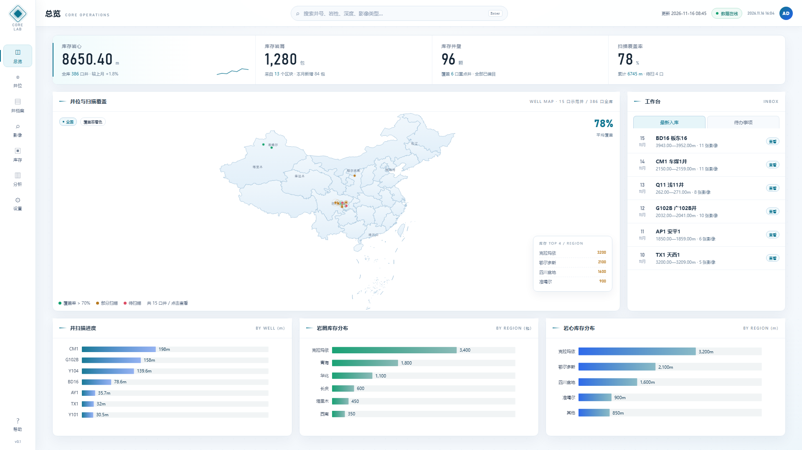
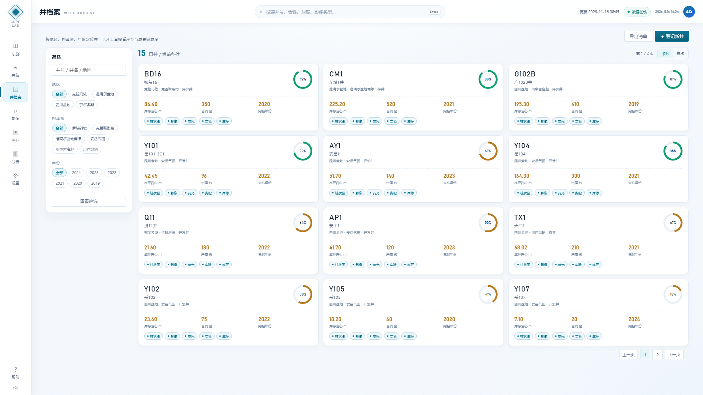
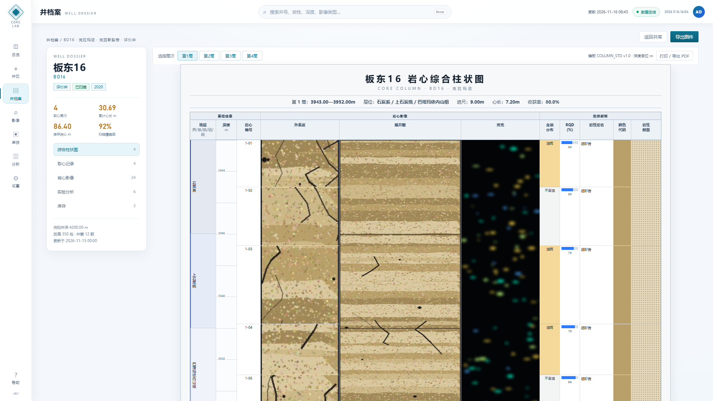
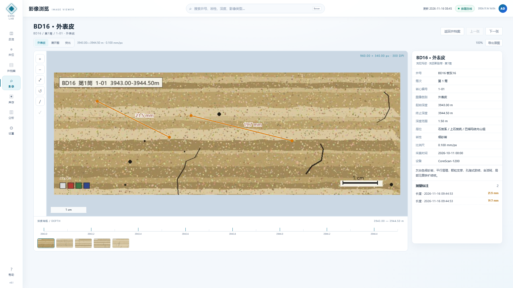

# 岩心数字化平台（初版）

按“浅色工作台 + 青蓝主色”做的可运行演示，但**信息架构没有照搬参考系统**：改为左侧工作区导航、顶部命令栏、卡片式井档案、档案侧栏式单井页、底部深度导航的影像页。覆盖总览、井位、井档案、综合柱状图、影像浏览与测量、库存、分析、设置。

> 这是**初版演示程序**，用于确认交互、页面结构和数据组织方式，不是生产系统。当前数据为 15 口示范井 + 合成岩心影像；全库指标按 386 口井口径展示。



## 快速启动

**Windows 直接双击 `start.bat`**（或右键 `start.ps1` 用 PowerShell 运行）。

首次启动会自动生成 `app/data/core.db` 和 `app/static/assets/core/*.jpg`，约需 1 分钟；之后直接启动。

手动启动：

```bash
python app/seed.py          # 首次运行，生成演示数据与影像
python app/server.py --port 8010
```

浏览器打开 <http://127.0.0.1:8010>。

依赖：Python 3.9+；生成影像需要 Pillow（`pip install pillow`）。服务本身只用 Python 标准库。

## 已实现

| 页面 | 内容 |
|---|---|
| 总览 `#/home` | 四段式“资产脉冲带”、井位地图 + 库存 TOP、工作台（最新入库/待办双标签）、三条横向洞察 |
| 井位 `#/map` | 中国地图 + 井位列表，点击井位进入井档案 |
| 井档案 `#/wells` | 左侧筛选轨（地区/构造带/年份）+ 卡片墙；覆盖率圆环、库存/岩屑/年份、成果 chips；可切表格视图；分页 |
| 井档案详情 `#/well/{id}` | 左侧档案栏（身份、四项指标、分区导航）；右侧综合柱状图（基础信息/岩心影像/地质解释三组）、取心记录、影像、实验、库存 |
| 影像浏览 `#/image/{id}` | 底部横向深度导航 + 缩略图带、左侧浮动工具条（缩放/测量/保存）、右侧信息面板、白光/展开/荧光切换、导出原图 |
| 影像检索 `#/search` | 按井号、岩性、描述、图像类型检索，结果分“井/岩心段/影像” |
| 库存台账 `#/inventory` | 库存汇总、按状态筛选、库位编码、登记流转（入库/借阅/取样/损耗，写 SQLite） |
| 分析 `#/stats` | 区域覆盖率、岩性分布、实验类型、库存状态 |
| 设置 `#/admin` | 用户/角色、字典编码、操作日志 |
| 帮助 `#/help` | 快速上手与数据说明 |





## 界面结构：有意与参考系统不同

保留参考图的“岩心影像 + 青蓝强调”气质，但页面骨架、信息层级和操作路径是重新设计的，避免甲方产生“逐屏照抄”的印象：

- **导航**：左侧工作区导航 + 顶部命令栏（全局搜索、状态、时钟），替代参考系统的顶部横向菜单。
- **总览**：资产脉冲带 → 地图 + 工作台 → 三条横向洞察；不再使用“左中右三栏 + 左侧三张图”的仪表盘结构。
- **井档案**：左侧筛选轨 + 卡片墙（可切换表格），替代“顶部筛选 + 宽矩阵表格”。
- **单井**：左侧档案栏 + 右侧分组柱状图（基础信息 / 岩心影像 / 地质解释），替代“顶部英雄区 + 横向标签页”。
- **影像**：底部横向深度导航 + 左侧浮动工具条 + 右侧信息面板，替代“左侧竖向标尺 + 顶部工具条”。
- **视觉**：浅色底、白色圆角面板、细线边框，去掉四角 HUD 边框；图表改为横向条形，减少“科幻大屏”感。

这样既保留岩心数字化的视觉识别，又让页面结构和参考系统区分开。

## 界面主题

- 默认浅色：`app/static/css/light.css` 在 `style.css` 之后加载，覆盖为白色/浅灰面板、深色文字与青蓝强调。
- 原深色样式仍保留在 `style.css`；如需回到深色，只需移除 `index.html` 中 `light.css` 的引用。
- `docs/screenshots/` 已更新为浅色截图；`docs/ppt_screenshots/` 和两版汇报 PPT 仍是深色素材，需要浅色版可另行生成。

## 目录

```
岩心数据库/
├─ app/
│  ├─ server.py          # HTTP 服务 + JSON API + 静态文件
│  ├─ seed.py            # SQLite 建表、种子数据、合成岩心影像
│  ├─ data/core.db       # 运行后生成
│  └─ static/
│     ├─ index.html
│     ├─ css/style.css
│     ├─ js/             # app / pages / charts / map / viewer / api
│     └─ assets/
│        ├─ china.json   # 中国省级 GeoJSON
│        └─ core/        # 合成影像、缩略图、纵向条带
├─ docs/screenshots/
├─ start.bat / start.ps1
└─ README.md
```

## 数据模型（SQLite）

`wells`、`runs`、`strata`、`sections`、`images`、`experiments`、`scans`、`products`、`inventory`、`txns`、`annotations`、`users`、`audit`、`meta`。

- 深度统一用 m、3 位小数，区间按“顶—底”存。
- 影像带 `top_md / bottom_md / mm_per_px`，测量按 `mm_per_px` 换算。
- 综合柱状图的图像道用 `strip_*.jpg`（段级）与 `*_v.jpg`（筒级纵向条带）。
- 成果矩阵来自 `products`，每口井 × 6 类成果。
- 标注写入 `annotations`，库存流转写入 `txns` 并更新 `inventory`。

## API

| 方法 | 路径 | 说明 |
|---|---|---|
| GET | `/api/overview` | 总览 KPI、图表、最新扫描、地图点 |
| GET | `/api/wells?q=&region=&year=&tectonic=&page=&page_size=` | 井列表 |
| GET | `/api/wells/{id}` | 井、回次、岩心段、影像、实验、库存 |
| GET | `/api/images/{id}` | 影像、同段影像、标注、上下张 |
| POST | `/api/images/{id}/annotations` | 保存测量标注 |
| GET | `/api/search?q=` | 综合检索 |
| GET | `/api/inventory?status=` | 库存列表 |
| POST | `/api/inventory/txn` | 登记库存流转 |
| GET | `/api/stats` | 分析页统计 |
| GET | `/api/admin` | 用户、字典、日志 |
| GET | `/api/health` | 健康检查 |

## 重新生成演示数据

```bash
python app/seed.py
```

会删除并重建 `app/data/core.db`、`app/static/assets/core/`，同时清空手工添加的标注与库存流转。

## 与正式方案的差距

- 数据导入：目前是种子数据，尚未接 Excel/扫描目录批量导入。
- 权限：只有界面展示，尚未接登录、RBAC、行级权限。
- 大图：演示图约 1000px；正式版需要 DZI/IIIF 瓦片与对象存储。
- 柱状图：模板为内置一套，正式版需要模板注册表与道配置编辑器。
- 三维/CT、AI 识别：未实现，已在方案中预留。

更完整的数据模型、格式对齐与功能规划见 `岩心数据库系统_调研与设计方案.md`。

## PPT 汇报截图（深色版）

按功能板块整理了 11 张 16:9 / 1920×1080 截图，可直接用于汇报：

- `docs/ppt_screenshots/`：按板块分文件夹存放
- `docs/ppt_screenshots/00_截图清单.md`：每张图的建议页标题与讲解要点
- `docs/ppt_screenshots/00_全部截图预览.png`：11 张总览拼图
- `岩心数字化平台_PPT截图_1920x1080.zip`：打包下载

板块顺序：总览 → 井位导航 → 井档案（卡片/表格）→ 单井综合柱状图 → 影像浏览与测量 → 影像检索 → 库存台账/流转 → 统计分析 → 系统管理。

## PPT 汇报文件（深色主题）

- [岩心数字化平台_汇报演示_2026.11.pptx](岩心数字化平台_汇报演示_2026.11.pptx)
- 13 页：封面 + 11 个功能板块 + 下一步；16:9，深色主题，每页带文字介绍和演讲备注。
- 截图源文件与清单仍在 `docs/ppt_screenshots/`；如需改图或换页，可直接替换同名文件。

## 总体方案 PPT

- [数字岩心智能化平台_总体方案_2026.11.pptx](数字岩心智能化平台_总体方案_2026.11.pptx)
- 16 页：封面 → 背景 → 痛点与目标 → 现状与边界 → 平台定位 → 业务流程 → 六大功能 → 典型应用 → 技术架构 → 数据架构 → 深度关联 → 图像智能 → 应用场景 → AI 技术路线 → 实施路径 → 预期成果。
- 含参考系统截图、总体技术架构图、数据架构图、深度关联示意与 AI 辅助标注示意；每页带演讲备注。

## 功能总结

- [数字岩心智能化平台_功能总结.docx](数字岩心智能化平台_功能总结.docx)
- 4 页：六大功能群、演示系统 10 个功能明细、4 个重点功能展开、跨模块能力、实现边界与一页汇报口径。
- 附“每个功能一句话”，可直接拆成 PPT 页面文字。

## 岩心数据对比报告

- [数字岩心智能化平台_岩心数据对比报告.docx](数字岩心智能化平台_岩心数据对比报告.docx)
- [PDF 版](数字岩心智能化平台_岩心数据对比报告.pdf)
- 6 页：对比范围与口径、总体结论、2017 岩心 13 项逐项对比、当前超出能力、关键缺口、补充建议、验收口径、附录。
- 基准：2017《钻井地质设计》第 4 页表 1-1“岩心资料（包括井壁取心）”13 项；当前侧以 `app/data/core.db` 实际表结构为准。

## 岩心数据模型补充

- [数字岩心智能化平台_岩心数据模型补充设计.docx](数字岩心智能化平台_岩心数据模型补充设计.docx)
- [PDF 版](数字岩心智能化平台_岩心数据模型补充设计.pdf)
- 新增：`core_observation`、`core_fracture`、`core_vug`、`core_sidewall`、`samples`、`coring_plan`、`image_calibration`、`dictionary`；扩展 `experiments`、`annotations`。
- 已应用到 `app/data/core.db`，并写入演示补充数据；迁移文件：`app/migrations/001_core_gap.sql`、`app/migrate_core_gap.py`。
- 文档包含：补充前后覆盖对比、补充后可存储的数据类型、树逻辑图与关系基数、典型 SQL、验收建议。
