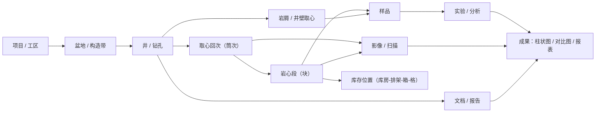
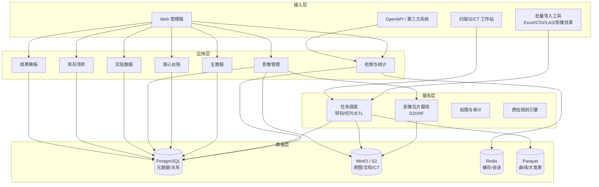
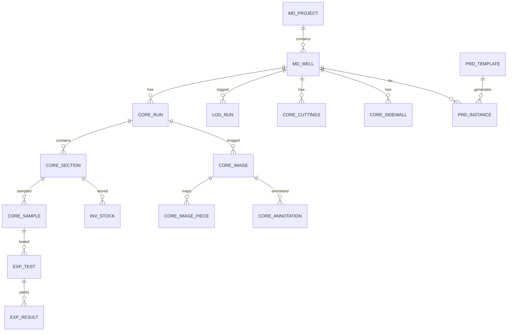
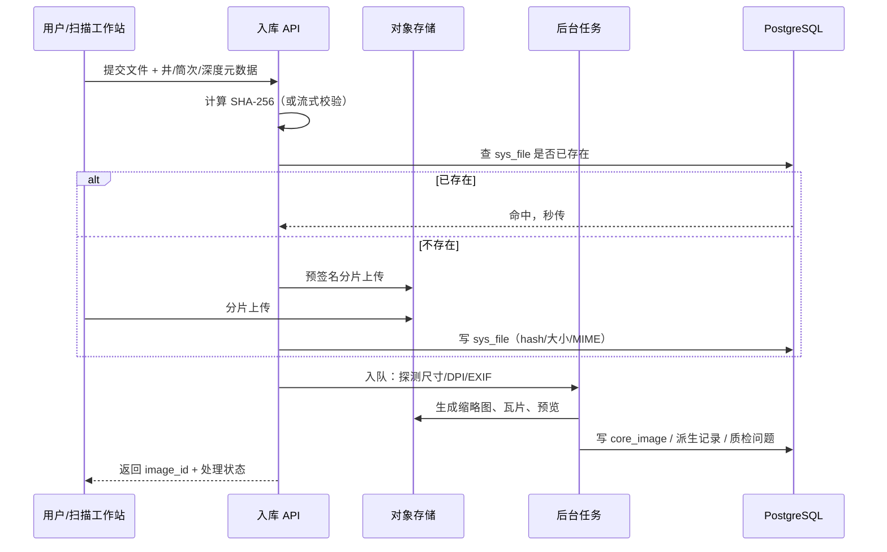
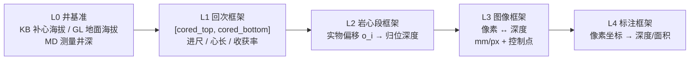
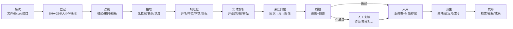
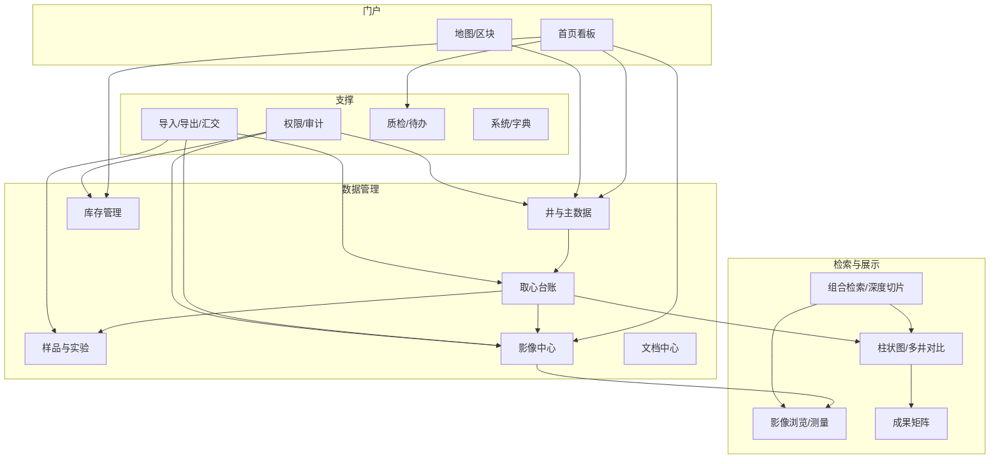

# 岩心数据库系统：调研与设计方案

> 版本：V0.9（讨论稿）　日期：2026-11-15　状态：调研与设计，**尚未进入开发**
>
> 本文只回答四个问题：**存什么、怎么存、不同格式怎么对齐、先做哪些功能**。文中的表结构、接口、界面均为设计建议，不是最终实现。

**建议阅读顺序**：决策者看 0、8、10；架构/开发看 3、4、5；地质/资料人员看 2、5.3、6.5。

---

## 0. 结论速览

岩心数据库的本质不是"把图片和表格放进数据库"，而是**围绕一根岩心的深度轴，把"实物—影像—描述—实验—成果—库存"六类记录对齐到同一个可追溯的坐标系统里**。参考系统已经把"看"做得很成熟，真正难的是"对得上、找得到、说得清"。

十条关键结论：

1. **主干模型用五级实体**：井（钻孔）→ 取心回次（筒次）→ 岩心段（块）→ 样品 → 实验/图像/描述。岩屑、井壁取心作为并列的实物对象扩展，不另起一套井模型。
2. **深度是唯一主键维度**：统一用测量井深 MD（m，3 位小数），区间用半开区间 `[top, bottom)`；同时保存补心海拔、地面海拔、深度基准，保证 MD/TVD/海拔可换算、可追溯。
3. **回次内深度归位默认"按收获率比例拉伸"**：采用 DD 2022—1.2 的 `H = H1 + L/S`，但必须把"归位方法、修正量、修正人"存成字段，不能把计算结果当成事实写死。
4. **影像不存"深度"，存"像素—深度标定"**：一张图带 `top_md/bottom_md + 标定方式 + 控制点 + 残差`；标注只存像素坐标，深度由标定实时换算。这样放大、裁剪、重新拼接后不会丢深度。
5. **元数据进关系库，原文件进对象存储**：PostgreSQL 管结构与关系，MinIO/S3 管原图/CT/视频/文档，按 SHA-256 内容寻址去重；瓦片、缩略图、预览图是可重建的派生资产。
6. **实验数据用"长表 + 参数字典"**：一项实验一行结果，参数可无限扩展；常用参数物化成宽表或 JSONB 生成列做索引，避免"每加一个实验项就改一次表"。
7. **成果模板用注册表，不要一模板一列**：参考系统井列表里 20 多列"综合柱状图/模板"就是反例；应存"模板 + 版本 + JSON 配置 + 生成实例"。
8. **检索分三层**：结构化组合检索（PG + 索引）、全文检索（zhparser/trigram）、空间与深度检索（PostGIS/GiST）；Elasticsearch 只在数据量和检索复杂度确实需要时再引入，避免过早双写。
9. **库存与扫描必须同源**：库存米数、扫描米数、覆盖率由库存流水和影像记录实时计算。参考看板出现"库存岩心 0.00 米"但实际有货，就是台账与业务脱节的典型信号。
10. **先做 3—5 口"样板井"的全类型闭环**，再批量导入。历史岩心数据的主要成本不是存储，而是井名、筒次、深度、岩性名的清洗与人工复核。

**建议的 MVP 边界**：主数据 + 取心台账 + 影像入库与浏览 + 深度切片检索 + 单井柱状图 + 基础统计 + 权限审计。库存实物流转、实验长表、多井对比放第二阶段；CT/三维、AI 识别放第三阶段。

---

## 1. 调研范围与方法

### 1.1 调研对象

| 类别 | 对象 | 用途 |
|---|---|---|
| 行业标准 | DD 2022—1.1《岩心数字化技术规程 第1部分：总则》 | 数据分类、L0/L1/L2 分级、成果提交、质检比例 |
| 行业标准 | DD 2022—1.2《岩心数字化技术规程 第2部分：表面图像数字化》 | 300 DPI 底线、扫描方式、拼接、深度重算公式、记录表字段 |
| 行业标准 | DD 2022—1 系列（光谱、XRF、CT、SEM、物性等部分） | 多参数数字化的数据类型与命名缩写 |
| 行业标准 | GB/T 29172—2012《岩心分析方法》 | 孔隙度、渗透率、饱和度等实验项与单位 |
| 行业标准 | DZ/T 0385—2021《实物地质资料整理技术要求》、DD 2010—5《岩心与样品采集管理技术要求》 | 整理、编号、入库、保管 |
| 参考系统 | 用户提供的 5 张截图（数字化平台首页、井号列表、综合柱状图、影像浏览、GeoAnalysis 测量） | 界面、字段、交互、成果形态 |
| 参考架构 | OSDU（Sample/Coring 域）、IODP 全生命周期数据模型、全国数字岩心平台 | 实体层级、样品与实验的组织方式 |
| 技术参考 | OME-Zarr/NGFF、DICOM、IIIF/DZI、LAS 2.0、glTF/3D Tiles | 大图、CT、曲线、三维的格式与切片方案 |

### 1.2 调研方法

1. **从界面反推模型**：把 5 张截图逐列拆解，得到"系统实际在管哪些对象、哪些字段、哪些统计口径"。
2. **从标准反推约束**：把标准中的强制项（分辨率、命名、深度公式、质检比例、备份份数）转成数据库约束和质检规则。
3. **从格式反推对齐**：列出每类数据"深度怎么表达、单位是什么、精度多少、由谁产生"，再设计统一的深度坐标系和转换链。
4. **从使用场景反推功能**：以"地质人员找一口井的一段岩心"和"管理人员看扫描进度"两条主线，倒推页面与接口。

### 1.3 不在本轮范围

- 不写代码、不建库、不选型采购、不做界面视觉设计。
- 不评估具体扫描仪/CT 设备型号。
- 不涉及与中石油 A1/A2、中石化、中海油等总部系统的接口细节，只在架构上预留。

---

## 2. 参考系统拆解

### 2.1 五个界面在解决什么问题

以下截图来自参考系统，仅用于反推数据模型与交互，不代表本项目的界面设计。

| 图 | 界面 | 看到的关键信息 | 反推的数据对象 | 可借鉴 | 需要改进 |
|---|---|---|---|---|---|
| 1 | 数字化平台首页 | 库存岩心（米）0.00、库存岩屑（包）0、库存井壁（颗）0；按井的岩心扫描统计、按地区的岩屑扫描统计；最新扫描信息（井号 + 深度段）；世界地图；库存数量统计；扫描工作量统计 | 库存指标、扫描批次、井、地区、深度段 | KPI + 最新动态 + 地图的三段式首页，信息密度合适；"最新扫描信息"直接给井号和深度段，可点击进图 | KPI 为 0.00 说明库存台账没接进来；地图是世界地图，对国内矿区应换成区块/构造带 + 井位；缺少"扫描覆盖率/待扫描"缺口指标 |
| 2 | 井号列表 | 筛选：地区、井号、井字、年份、构造带；表格列：序号、地区、井号；"综合柱状图"下 20 多列成果模板（1岩心基本、2岩心组合图、3图切荧光、4岩层组合图、test、v10岩心、v10多井对比、含油、克拉玛依问题模板、曲线、图像、岩心_v8、岩心相似度、综合图模板、中油测井天津、钻孔柱状图、03岩屑模板……）；统计列：岩心（米）、岩屑（包） | 井、成果模板、成果实例、统计口径 | "一口井一行 + 成果矩阵"的呈现方式，业务人员一眼能看出哪口井缺什么成果；图标即入口，操作路径短 | 模板被做成固定列，每加一个模板就要改表、改代码、改权限；列名带版本号（v8/v10）说明模板版本没有纳入模型；统计列只有结果没有口径 |
| 3 | 岩心综合柱状图 | 标题"板东16 岩心综合柱状图"；表头：地层（界/系/统/组/段）、深度、岩心编号、柱状图像、岩心展开图像、荧光图像、荧光外表面图像、含油分布、RQD（%）、岩性定名、颜色代码、岩性剖面；井段信息：第1筒、2xxx.70—2958.21m、层位、进尺、心长、收获率 | 地层、深度、岩心段、多类图像、描述、RQD、岩性、颜色、岩性剖面符号 | 深度轴统一、多道并列，是"对齐"的最终呈现形态；筒次头信息把进尺/心长/收获率放在一起，符合地质习惯 | 道（track）是硬编码的，不能按项目配置；图像道没有标定信息；RQD、含油分布是解释结果，应与原始描述分开存储 |
| 4 | 岩心影像浏览 | 左侧深度标尺 3943.4—3944.6 + 缩略图；中间大幅外表皮图像，底部 1cm 比例尺；右侧元数据：井号 板东16、筒次 1、岩心编号 1-29、图像类别 外表皮、起始深度 3943.34m、终止深度 3943.42m、深度范围 0.08m、层位 石炭系、岩心描述；工具条：缩小/最佳尺寸/放大/还原/自动旋转/改变三维显示方向/区域保存/测量面积/裂缝/孔洞/荧光分析 | 井、筒次、岩心段、图像、图像类型、深度区间、描述、标注 | "深度标尺 + 缩略图 + 大图 + 元数据面板"四区布局成熟；工具条直接对应地质人员的测量需求 | 深度范围只有 0.08m，说明是单段小图；缺少"这张图的像素—深度标定"入口；测量结果没有说明存在哪里、能否导出 |
| 5 | GeoAnalysis 测量 | 上下/左右标尺、可旋转的红色测量线、缩放 19%、文件名页签 | 图像、标尺、测量线、缩放状态 | 标尺 + 任意角度测量的交互，适合裂缝/层理产状测量 | 依赖外部工具，测量结果难回写数据库；缺少与井/深度/岩心段的关联 |

### 2.2 从界面反推的对象清单

参考系统实际管理的对象，比它展示出来的多：

- **空间与组织**：项目/工区、盆地、构造带、地区、油气田、井（钻孔）。
- **取心**：筒次/回次、取心井段、进尺、心长、收获率、岩心直径、取心方式。
- **实物**：岩心段/块、岩心箱、箱内格位、库房/排架、岩屑包、井壁取心颗。
- **影像**：外表皮、展开图、荧光、荧光外表面、岩心箱照片、薄片、CT 切片、SEM、三维模型、综合柱状图。
- **描述**：岩性、颜色、粒度、结构、构造、含有物、化石、接触关系、裂缝、孔洞、含油级别、荧光级别、RQD。
- **实验**：物性、粒度、碳酸盐、粘土矿物、TOC、Ro、薄片鉴定、力学、相渗、压汞、核磁。
- **成果**：单井柱状图、多井对比图、成果表、报告。
- **管理**：扫描批次、扫描人员、设备、质检记录、借阅/取样/盘点流水。

#### 2.2.1 界面字段到模型的映射

| 界面 | 界面字段 | 落到哪里 |
|---|---|---|
| 影像浏览（图4） | 井号 | `md_well.well_code` |
| 影像浏览 | 筒次 | `core_run.run_no` |
| 影像浏览 | 岩心编号 | `core_section.section_no` |
| 影像浏览 | 图像类别 | `core_image.image_type` |
| 影像浏览 | 起始/终止深度 | `core_image.top_md/bottom_md` |
| 影像浏览 | 深度范围 | `bottom_md − top_md`（派生） |
| 影像浏览 | 层位 | `core_run.stratum_id` → `md_stratum` |
| 影像浏览 | 岩心描述 | `core_description.desc_text` |
| 柱状图（图3） | 界/系/统/组/段 | `md_stratum` 的层级 |
| 柱状图 | 岩心编号 | `core_section.section_no` |
| 柱状图 | 柱状/展开/荧光图像 | `core_image.image_type` 三道 |
| 柱状图 | 含油分布 | `core_description.oil_show` + `core_fracture` |
| 柱状图 | RQD（%） | `core_description.rqd_pct` |
| 柱状图 | 岩性定名 | `core_description.lithology_id` |
| 柱状图 | 颜色代码 | `md_lithology.color` |
| 柱状图 | 岩性剖面 | 模板符号库（按岩性编码映射） |
| 井列表（图2） | 地区/构造带 | `md_field` / `md_tectonic_unit` |
| 井列表 | 成果列 | `prd_template` + `prd_instance` |
| 井列表 | 岩心（米） | `SUM(core_section.length_m)` |
| 井列表 | 岩屑（包） | `SUM(core_cuttings.packages)` |

这张表说明：参考系统的每个可见字段，都能在模型中找到一个"有明确归属"的落点；找不到落点的字段，要么是派生指标，要么是模板配置，不应该硬加列。

### 2.3 五个必须避免的坑

1. **不要把模板做成列**。参考系统 20 多列模板，每列背后都是一套代码和权限；正确做法是模板注册表 + 实例表 + 配置 JSON。
2. **不要把图像存成 BLOB**。原图动辄几百 MB 到几 GB，数据库只存对象键和元数据。
3. **不要用文件名当主键**。文件名会改、会重、会带中文括号；主键必须是内部 UUID，文件名只是属性。
4. **不要在应用层拼深度字符串**。深度必须是数值列 + 单位 + 基准，否则无法比较、无法建索引、无法做区间查询。
5. **不要覆盖原始数据**。原始扫描图（L0）、处理图（L1）、解释成果（L2）分层存放；修正用新版本 + 审计，不 UPDATE 原值。

---

## 3. 存什么：数据资产与对象模型

### 3.1 业务主线



主线是"井—回次—段—样品—实验"，影像、描述、文档、库存、成果都挂在主线的某个节点上。**岩屑和井壁取心不是另一条主线**，它们是样品类型不同、计量单位不同（包/颗），共用井和深度轴。

### 3.2 对象清单

| # | 对象 | 说明 | 关键字段 | 单井典型量级 |
|---|---|---|---|---|
| 1 | 项目/工区 | 数据归属与权限边界 | 项目编码、名称、单位、起止时间 | 1 |
| 2 | 盆地 | 一级构造单元 | 名称、编码 | 1 |
| 3 | 构造单元 | 构造带/二级单元，自关联树 | 名称、父级、类型 | 1—5 |
| 4 | 油气田/区块 | 井的归属 | 名称、编码 | 1—3 |
| 5 | 井/钻孔 | 核心主数据 | 井号、井型、坐标、坐标系、地面海拔、补心海拔、完钻井深、开钻/完钻日期 | 1 |
| 6 | 井名别名 | 历史井名、简写、错写 | 别名、来源、置信度 | 0—5 |
| 7 | 地层字典 | 界/系/统/组/段 | 编码、名称、父级、年代 | 20—80 |
| 8 | 岩性字典 | 岩性名称与代码 | 编码、名称、大类、颜色 | 30—150 |
| 9 | 取心回次 | 筒次/回次 | 筒次号、取心顶底深、进尺、心长、收获率、岩心直径、取心方式、日期 | 5—50 |
| 10 | 岩心段 | 回次内的块/段 | 块号、顶底深、长度、箱号、格号、方向、状态 | 30—500 |
| 11 | 岩心缺失段 | 收获率不足造成的空段 | 顶底深、缺失原因、长度 | 0—50 |
| 12 | 岩心箱 | 实物箱 | 箱号、类型、规格、所属库房 | 10—100 |
| 13 | 库房/排架 | 存放位置树 | 库房、排、架、层、格、温湿度 | 1—20 |
| 14 | 岩心样品 | 从岩心上取的样 | 样品号、类型、顶底深/点深、距顶、方向、用途、状态、剩余量 | 100—1000 |
| 15 | 岩屑样品 | 岩屑录井/分析样 | 包号、顶底深、包数、采样方式、描述、荧光 | 100—2000 |
| 16 | 井壁取心 | 井壁取心颗 | 颗号、深度、取心枪、岩性、分析 | 0—200 |
| 17 | 岩心描述 | 分段描述 | 顶底深、岩性、颜色、粒度、结构、构造、含有物、接触关系、含油级别、荧光级别 | 30—500 |
| 18 | 裂缝/孔洞 | 描述或图像解释出的地质体 | 类型、顶底深、产状、长度、宽度、充填物、图像坐标 | 0—5000 |
| 19 | 扫描批次 | 一次扫描/拍摄任务 | 批次号、设备、光源、方式、操作员、日期、质检状态 | 5—50 |
| 20 | 影像 | 一张可浏览的图 | 类型、光源、L 级、顶底深、像素宽高、DPI、mm/px、标定、文件 | 500—5000 |
| 21 | 影像分段 | 一张图覆盖多个岩心段时的映射 | 影像、段、像素框/多边形、顶底深 | 1—20/图 |
| 22 | 标注/测量 | 长度、面积、角度、裂缝、孔洞、荧光面积 | 类型、几何、数值、单位、深度、作者 | 0—10000 |
| 23 | 三维模型 | 结构光/摄影测量模型 | 格式、坐标系、比例、文件 | 0—20 |
| 24 | CT 扫描 | 多尺度 CT | 分辨率、体素尺寸、能量、文件、切片范围 | 0—20 |
| 25 | 实验 | 一次实验 | 实验类型、标准、实验室、仪器、日期、样品 | 100—1000 |
| 26 | 实验结果 | 实验项 | 参数、值、单位、方法、质量标记 | 500—10000 |
| 27 | 测井曲线 | LAS 曲线集 | 曲线名、单位、顶底深、步长、空值、基准 | 1—20 |
| 28 | 文档 | 报告、记录表、资质 | 类型、标题、文件、页数、密级 | 5—50 |
| 29 | 成果模板 | 柱状图/对比图模板 | 编码、版本、道配置、页面配置 | 5—30 |
| 30 | 成果实例 | 某井某模板生成的结果 | 模板版本、井、参数、状态、输出文件 | 10—100 |
| 31 | 库存流水 | 入库/出库/移库/取样/损耗 | 类型、对象、数量、单位、位置、操作人、审批人 | 10—100 |
| 32 | 借阅/取样申请 | 外部借阅与取样 | 申请人、用途、审批、期限、归还 | 0—50 |
| 33 | 导入批次 | 一次批量导入 | 来源、模板、总数、成功/失败、错误明细 | 按需 |
| 34 | 质检问题 | 规则命中与人工复核 | 规则、对象、严重级、状态、处理人 | 按需 |
| 35 | 审计日志 | 谁在何时改了什么 | 用户、操作、对象、前后值、IP、时间 | 按需 |

> 补充：`md_stratum` 只是地层字典；每口井还需要 `well_stratum`（井分层顶底深）。综合柱状图的地层道、多井对比的层位对齐都依赖它，光有字典画不出分层。

#### 3.2.1 三类实物、四种计量单位

参考系统首页同时出现"库存岩心（米）/岩屑（包）/井壁（颗）"，说明不能用一张表、一个单位硬套：

| 对象 | 计量单位 | 深度表达 | 关键字段 | 库存状态 |
|---|---|---|---|---|
| 岩心段 | 米/段 | 区间 `[top, bottom)` | 段长、箱号、格号、完整性 | 在库/借出/取样/损耗/销毁 |
| 岩心样品 | 件 | 点深或区间 | 样品类型、用途、剩余量、父样品 | 待取/已取/实验中/已用完 |
| 岩屑 | 包 | 区间 + 包号 | 包数、采样方式、描述、荧光 | 在库/借出/损耗 |
| 井壁取心 | 颗 | 点深 | 颗数、取心枪、岩性、分析 | 在库/借出/损耗 |

建模上共用"井 + 深度"主线，但库存表 `inv_stock` 必须带 `unit` 字段（m/包/颗/件），聚合时按单位分组，不能把"米"和"包"加在一起。

### 3.3 数据分类与存储位置

| 数据类别 | 具体内容 | 主存储 | 格式/形态 | 说明 |
|---|---|---|---|---|
| 结构化元数据 | 井、回次、段、样品、实验、库存、权限 | PostgreSQL | 行/列 | 事务一致、可 JOIN、可约束 |
| 半结构化属性 | 描述、模板配置、标定点、扩展字段 | PostgreSQL JSONB | JSON | 有 schema 校验，常用字段抽成生成列 |
| 原始影像 | L0 扫描原图、照片、荧光、薄片 | 对象存储 MinIO/S3 | JPG/TIFF/BigTIFF | 内容寻址、只读、版本化 |
| 处理影像 | L1 裁剪/拼接/色彩校正 | 对象存储 | JPG/TIFF | 可重生成，保留处理参数 |
| 浏览派生 | 缩略图、预览图、瓦片金字塔 | 对象存储 + 边缘缓存 | WebP/JPEG/DZI | 可重建，按需生成 |
| CT/三维 | DICOM 序列、OME-Zarr、OBJ/PLY/glTF | 对象存储/高性能盘 | DICOM/Zarr/glTF | 体量大，单独容量池 |
| 测井曲线 | LAS、SEG-Y | Parquet + PG 元数据 | 列式 | 百万级采样点不进 PG 行存 |
| 文档 | PDF/Word/Excel/PPT | 对象存储 + PG 元数据 | 原格式 | 全文检索另建索引 |
| 视频 | 岩心旋转/扫描过程 | 对象存储 | MP4/H.264 | 转码后提供流播 |
| 检索索引 | 全文、井名模糊、空间 | PG GIN/GiST/trgm | 索引 | 可重建，不作为唯一数据源 |
| 缓存/会话 | 登录、热点瓦片、任务状态 | Redis | KV | 可丢 |

### 3.4 指标口径（必须先定义，再写代码）

同一张看板出现"库存岩心 0.00 米"而库房有货，通常不是数据没录，而是**口径没定义**。建议把下列指标写成字典表 `md_metric`，每个指标带公式、单位、数据源、刷新频率。

| 指标 | 定义 | 公式 | 数据来源 | 注意 |
|---|---|---|---|---|
| 取心进尺 | 实际取心井段长度 | Σ(回次底深 − 回次顶深) | 取心回次 | 不是心长 |
| 心长 | 实际取回岩心长度 | Σ 岩心段长度 | 岩心段 | 与进尺的差是缺失 |
| 收获率 | 心长/进尺 | 心长 ÷ 进尺 × 100% | 回次 | 允许 >100% 但需标记异常 |
| 库存岩心（米） | 在库岩心的实物长度 | Σ 状态为"在库"的岩心段长度 | 岩心段 + 库存流水 | 不含借出、损耗、销毁 |
| 库存岩屑（包） | 在库岩屑包数 | Σ 状态为"在库"的包数 | 岩屑样品 | 单位是包，不是米 |
| 库存井壁（颗） | 在库井壁颗数 | Σ 状态为"在库"的颗数 | 井壁取心 | 单位是颗 |
| 扫描岩心（米） | 已有有效影像覆盖的岩心长度 | 按井合并影像深度区间后求并集长度 | 影像 | 同一段多张图只算一次 |
| 扫描覆盖率 | 扫描岩心/库存岩心 | 扫描米数 ÷ 库存米数 | 影像 + 岩心段 | 分子分母口径要一致 |
| 图像张数 | 有效影像数量 | COUNT(影像) | 影像 | 排除失败/重复 |
| 实验项次 | 实验结果的参数条数 | COUNT(结果) | 实验结果 | 不是样品数 |
| 成果完成率 | 已生成成果的井/应生成井 | 成果实例 ÷ 井×模板 | 成果实例 | 按模板分别统计 |

### 3.5 最小必填集（导入门槛）

不求一次录全，但下列字段缺失就无法建立深度轴，必须拦：

| 对象 | 最小必填 |
|---|---|
| 井 | 井号、项目、坐标（或经纬度）、坐标系、地面海拔、补心海拔、完钻井深 |
| 回次 | 井号、筒次、取心顶深、取心底深、进尺、心长、收获率 |
| 岩心段 | 回次、块号、顶深、底深、长度、状态 |
| 样品 | 样品号、井、类型、深度（点或区间）、用途 |
| 影像 | 井、类型、顶深、底深、文件、像素宽高、DPI 或 mm/px |
| 实验 | 样品、实验类型、实验室、日期、标准（或方法） |
| 库存 | 对象、位置、数量、单位、状态 |

**原则**：最小必填集只保证"能对齐、能追溯"，不追求"一次录全"。其余字段允许后补，但要有"完整度评分"提示。

---

## 4. 怎么存：分层存储与核心表结构

### 4.1 总体架构



设计要点：

- **一个事实只存一处**：井的坐标只在 `md_well`，影像只在对象存储，数据库存指针；统计从事实表算，不另建"统计表"手工维护。
- **原始与派生分离**：L0 原始图只读，L1/L2 可重生成；即使瓦片全丢，也能从原图重建。
- **元数据与文件解耦**：文件换存储、换桶、换域名，不影响业务表；`sys_file` 是唯一文件入口。
- **同步可重建**：搜索索引、物化视图、缓存都可以从主库重建，不作为唯一数据源。

### 4.2 存储选型

| 需求 | 推荐 | 备选 | 理由 |
|---|---|---|---|
| 结构化元数据 | PostgreSQL 16+ | openGauss/达梦（信创） | JSONB、GiST、PostGIS、全文、扩展丰富；开源可控 |
| 对象/影像 | MinIO（S3 兼容） | 本地文件系统、HDFS、云 OSS | S3 API 成熟、生命周期、分片上传、可换后端 |
| 缓存 | Redis | — | 会话、热点瓦片、任务队列 |
| 全文检索 | PG + zhparser/pg_jieba | Elasticsearch/OpenSearch | 初期数据量下 PG 足够；ES 增加双写与运维成本 |
| 曲线/大宽表 | Parquet + DuckDB | ClickHouse、TimescaleDB | 列式压缩、按井/曲线裁剪、分析快 |
| 向量检索 | pgvector | Milvus | V2 图像相似检索再引入 |
| 任务队列 | Celery/RQ（Python）或 Spring Batch | — | 转码/切片/ETL 必须异步 |

**不建议**：把影像 BLOB 存 PG；用 MongoDB 存全部元数据（关系查询会吃亏）；一开始就上 ES + 图数据库 + 数据湖（复杂度远超收益）。

### 4.3 核心表结构

#### 4.3.1 实体关系



#### 4.3.2 表清单

| 分组 | 表 | 作用 | 关键字段 |
|---|---|---|---|
| 主数据 | `md_project` | 项目/工区 | 编码、名称、单位 |
| 主数据 | `md_basin` / `md_tectonic_unit` / `md_field` | 盆地/构造/区块 | 名称、父级 |
| 主数据 | `md_well` | 井/钻孔 | 井号、坐标、海拔、深度基准、完钻井深 |
| 主数据 | `md_well_alias` | 井名别名 | 别名、来源、置信度 |
| 主数据 | `md_stratum` | 地层字典 | 界系统组段、父级 |
| 主数据 | `well_stratum` | 井分层 | 井、层位、顶底深、来源 |
| 主数据 | `md_lithology` | 岩性字典 | 名称、大类、颜色 |
| 主数据 | `md_dict` / `md_dict_item` | 通用字典 | 类型、编码、名称、排序 |
| 主数据 | `md_user` / `md_role` / `md_user_role` | 用户权限 | 账号、角色、数据域 |
| 岩心 | `core_run` | 取心回次 | 筒次、顶底深、进尺、心长、收获率 |
| 岩心 | `core_section` | 岩心段 | 块号、顶底深、长度、箱/格、状态 |
| 岩心 | `core_loss` | 缺失段 | 顶底深、原因 |
| 岩心 | `core_box` / `core_box_slot` | 岩心箱/格位 | 箱号、规格、位置 |
| 岩心 | `core_sample` | 岩心样品 | 样品号、类型、深度、用途、状态 |
| 岩心 | `core_cuttings` | 岩屑样品 | 包号、顶底深、包数 |
| 岩心 | `core_sidewall` | 井壁取心 | 颗号、深度、颗数 |
| 岩心 | `core_description` | 岩心描述 | 顶底深、岩性、颜色、构造、含油、荧光 |
| 岩心 | `core_fracture` / `core_vug` | 裂缝/孔洞 | 类型、深度、产状、图像坐标 |
| 影像 | `core_scan_session` | 扫描批次 | 设备、光源、方式、操作员、日期 |
| 影像 | `core_image` | 影像 | 类型、顶底深、像素、DPI、标定 |
| 影像 | `core_image_piece` | 影像-岩心段映射 | 像素框/多边形、顶底深 |
| 影像 | `core_image_annotation` | 标注/测量 | 类型、几何、数值、单位 |
| 影像 | `core_3d_model` / `core_ct_scan` | 三维/CT | 格式、分辨率、体素、文件 |
| 实验 | `exp_test` | 实验 | 样品、类型、标准、实验室、日期 |
| 实验 | `exp_result` | 实验结果 | 参数、值、单位、方法 |
| 实验 | `exp_param` / `exp_method` | 参数/方法字典 | 编码、名称、单位、标准 |
| 实验 | `log_run` / `log_curve` | 测井曲线 | 曲线集、步长、空值、基准、文件 |
| 文档 | `doc_asset` | 文档 | 类型、标题、文件、密级 |
| 成果 | `prd_template` | 成果模板 | 编码、版本、道配置 JSON |
| 成果 | `prd_instance` | 成果实例 | 模板版本、井、参数、状态、输出 |
| 库存 | `inv_location` | 库房/排架/箱/格 | 类型、父级、编码、容量 |
| 库存 | `inv_stock` | 库存快照 | 对象、位置、数量、单位、状态 |
| 库存 | `inv_txn` | 出入库流水 | 类型、对象、数量、位置、审批 |
| 库存 | `inv_loan` / `inv_check` | 借阅/盘点 | 申请人、期限、差异 |
| 系统 | `sys_file` | 文件对象 | SHA-256、桶、键、大小、MIME |
| 系统 | `sys_file_derivative` | 派生文件 | 类型、宽高、格式、源文件 |
| 系统 | `sys_import_batch` / `sys_import_row` | 导入批次/行 | 来源、模板、错误 |
| 系统 | `sys_qc_rule` / `sys_qc_issue` | 质检规则/问题 | 规则、对象、严重级、状态 |
| 系统 | `sys_audit_log` | 审计 | 用户、操作、对象、前后值 |
| 系统 | `sys_job` | 后台任务 | 类型、状态、进度、错误 |

#### 4.3.3 关键 DDL（节选）

```sql
CREATE EXTENSION IF NOT EXISTS btree_gist;
CREATE EXTENSION IF NOT EXISTS pg_trgm;
CREATE EXTENSION IF NOT EXISTS postgis;

-- 井：坐标、海拔、深度基准是深度换算的前提
CREATE TABLE md_well (
  well_id           uuid PRIMARY KEY DEFAULT gen_random_uuid(),
  project_id        uuid NOT NULL REFERENCES md_project(project_id),
  well_code         varchar(64)  NOT NULL,          -- 规范井号
  well_name         varchar(128) NOT NULL,
  well_type         varchar(32)  NOT NULL,          -- 探井/评价井/开发井/参数井/水文井
  basin_id          uuid REFERENCES md_basin(basin_id),
  tectonic_unit_id  uuid REFERENCES md_tectonic_unit(unit_id),
  field_id          uuid REFERENCES md_field(field_id),
  longitude         numeric(10,7),
  latitude          numeric(10,7),
  epsg_code         integer DEFAULT 4326,           -- CGCS2000=4490, WGS84=4326
  geom              geography(Point,4326),
  ground_elev_m     numeric(8,2),                   -- 地面海拔
  kb_elev_m         numeric(8,2),                   -- 补心海拔
  depth_ref         varchar(8) NOT NULL DEFAULT 'KB', -- KB/GL/DF
  spud_date         date,
  completion_date   date,
  final_depth_m     numeric(10,2),
  well_status       varchar(16) DEFAULT 'DRILLED',
  confidentiality   varchar(16) DEFAULT 'INTERNAL',
  source_system     varchar(64),
  source_id         varchar(128),
  remark            text,
  created_at        timestamptz NOT NULL DEFAULT now(),
  updated_at        timestamptz NOT NULL DEFAULT now(),
  deleted_at        timestamptz,
  CONSTRAINT uq_well_code UNIQUE (project_id, well_code),
  CONSTRAINT ck_well_depth_ref CHECK (depth_ref IN ('KB','GL','DF')),
  CONSTRAINT ck_well_lonlat CHECK (
    (longitude IS NULL AND latitude IS NULL)
    OR (longitude BETWEEN -180 AND 180 AND latitude BETWEEN -90 AND 90)
  )
);
CREATE INDEX ix_well_geom ON md_well USING gist (geom);

-- 井分层：地层字典只给名称，柱状图的地层道需要每口井的顶底深
CREATE TABLE well_stratum (
  well_stratum_id uuid PRIMARY KEY DEFAULT gen_random_uuid(),
  well_id         uuid NOT NULL REFERENCES md_well(well_id),
  stratum_id      uuid NOT NULL REFERENCES md_stratum(stratum_id),
  top_md          numeric(10,3) NOT NULL,
  bottom_md       numeric(10,3) NOT NULL,
  source          varchar(24) DEFAULT 'MUDLOG',   -- MUDLOG/LOG/GEOLOGY
  confidence      varchar(16) DEFAULT 'MEDIUM',
  remark          text,
  CONSTRAINT ck_ws_depth CHECK (bottom_md > top_md)
);
CREATE INDEX ix_ws_well_depth ON well_stratum
  USING gist (well_id, numrange(top_md, bottom_md, '[)'));

-- 回次：进尺/心长/收获率可由顶底深与心长派生，避免手填不一致
CREATE TABLE core_run (
  run_id              uuid PRIMARY KEY DEFAULT gen_random_uuid(),
  well_id             uuid NOT NULL REFERENCES md_well(well_id),
  run_no              integer NOT NULL,
  run_type            varchar(24) NOT NULL DEFAULT 'CONVENTIONAL',
  cored_top_md        numeric(10,3) NOT NULL,
  cored_bottom_md     numeric(10,3) NOT NULL,
  footage_m           numeric(10,3) GENERATED ALWAYS AS (cored_bottom_md - cored_top_md) STORED,
  core_length_m       numeric(10,3) NOT NULL,
  recovery_pct        numeric(6,3) GENERATED ALWAYS AS (
                        CASE WHEN cored_bottom_md > cored_top_md
                             THEN core_length_m / (cored_bottom_md - cored_top_md) * 100
                        END) STORED,
  core_diameter_mm    integer,
  depth_assign_method varchar(24) NOT NULL DEFAULT 'PROPORTIONAL',
  depth_shift_m       numeric(8,3) NOT NULL DEFAULT 0,
  stratum_id          uuid REFERENCES md_stratum(stratum_id),
  lithology_id        uuid REFERENCES md_lithology(lith_id),
  drilling_date       date,
  barrel_type         varchar(64),
  drilling_fluid      varchar(64),
  source_system       varchar(64),
  source_ref          varchar(256),
  remark              text,
  created_at          timestamptz NOT NULL DEFAULT now(),
  updated_at          timestamptz NOT NULL DEFAULT now(),
  deleted_at          timestamptz,
  CONSTRAINT uq_run_no UNIQUE (well_id, run_no),
  CONSTRAINT ck_run_depth CHECK (cored_top_md >= 0 AND cored_bottom_md > cored_top_md),
  CONSTRAINT ck_run_len CHECK (core_length_m >= 0),
  CONSTRAINT ck_run_method CHECK (depth_assign_method IN
    ('PROPORTIONAL','GAP_BOTTOM','GAP_DISTRIBUTED','ANCHOR_MANUAL'))
);
-- 深度区间统一用 [top, bottom)；btree_gist 支持 uuid + numrange 组合
CREATE INDEX ix_run_well_depth ON core_run
  USING gist (well_id, numrange(cored_top_md, cored_bottom_md, '[)'));

-- 岩心段：既存归位后的深度，也存距回次顶的实物偏移，便于反算
CREATE TABLE core_section (
  section_id    uuid PRIMARY KEY DEFAULT gen_random_uuid(),
  run_id        uuid NOT NULL REFERENCES core_run(run_id) ON DELETE CASCADE,
  well_id       uuid NOT NULL REFERENCES md_well(well_id),
  section_no    integer NOT NULL,
  top_md        numeric(10,3) NOT NULL,
  bottom_md     numeric(10,3) NOT NULL,
  length_m      numeric(8,3) NOT NULL,
  top_offset_m  numeric(8,3),                  -- 距回次顶的实物长度
  orientation   varchar(8) DEFAULT 'UP',
  azimuth_deg   numeric(6,2),
  box_id        uuid REFERENCES core_box(box_id),
  slot_no       varchar(16),
  condition     varchar(24) DEFAULT 'INTACT',
  stock_status  varchar(24) NOT NULL DEFAULT 'IN_STOCK',
  is_scanned    boolean NOT NULL DEFAULT false,
  remark        text,
  created_at    timestamptz NOT NULL DEFAULT now(),
  updated_at    timestamptz NOT NULL DEFAULT now(),
  deleted_at    timestamptz,
  CONSTRAINT uq_section_no UNIQUE (run_id, section_no),
  CONSTRAINT ck_section_depth CHECK (bottom_md > top_md),
  CONSTRAINT ck_section_len CHECK (length_m > 0),
  CONSTRAINT ck_section_orient CHECK (orientation IN ('UP','DOWN','UNKNOWN'))
);
CREATE INDEX ix_section_well_depth ON core_section
  USING gist (well_id, numrange(top_md, bottom_md, '[)'));

-- 影像：深度不是"写死"的，而是由标定参数换算
CREATE TABLE core_image (
  image_id        uuid PRIMARY KEY DEFAULT gen_random_uuid(),
  well_id         uuid NOT NULL REFERENCES md_well(well_id),
  run_id          uuid REFERENCES core_run(run_id),
  section_id      uuid REFERENCES core_section(section_id),
  scan_session_id uuid REFERENCES core_scan_session(session_id),
  image_type      varchar(24) NOT NULL,
  light_source    varchar(16) NOT NULL DEFAULT 'WHITE',
  data_level      varchar(4)  NOT NULL DEFAULT 'L1',
  file_id         uuid NOT NULL REFERENCES sys_file(file_id),
  top_md          numeric(10,3) NOT NULL,
  bottom_md       numeric(10,3) NOT NULL,
  depth_axis      varchar(4) DEFAULT 'X',       -- X=横向为深度, Y=纵向
  width_px        integer NOT NULL,
  height_px       integer NOT NULL,
  dpi_x           numeric(8,2),
  dpi_y           numeric(8,2),
  mm_per_px       numeric(10,6),                -- 实物比例，非深度比例
  calib_method    varchar(24) NOT NULL DEFAULT 'LINEAR',
  calib_points    jsonb,                        -- 控制点/分段标定
  calib_rmse_mm   numeric(8,3),
  has_scale_bar   boolean DEFAULT false,
  has_color_card  boolean DEFAULT false,
  captured_at     timestamptz,
  device_model    varchar(128),
  operator_id     uuid REFERENCES md_user(user_id),
  is_primary      boolean NOT NULL DEFAULT false,
  quality_flag    varchar(16) DEFAULT 'OK',
  remark          text,
  created_at      timestamptz NOT NULL DEFAULT now(),
  deleted_at      timestamptz,
  CONSTRAINT ck_image_depth CHECK (bottom_md >= top_md),
  CONSTRAINT ck_image_type CHECK (image_type IN
    ('SURFACE','ROLLED','FLUORESCENCE','FLUOR_SURFACE','BOX',
     'THIN_SECTION','CT_SLICE','SEM','COLUMN','OTHER')),
  CONSTRAINT ck_image_light CHECK (light_source IN ('WHITE','UV','BLUE','XP','MIXED')),
  CONSTRAINT ck_image_level CHECK (data_level IN ('L0','L1','L2'))
);
CREATE INDEX ix_image_well_depth ON core_image
  USING gist (well_id, numrange(top_md, bottom_md, '[)'));
CREATE INDEX ix_image_type ON core_image (image_type, captured_at DESC);

-- 实验结果：长表 + 参数字典，参数可扩展；同一参数可重复测量
CREATE TABLE exp_result (
  result_id    uuid PRIMARY KEY DEFAULT gen_random_uuid(),
  test_id      uuid NOT NULL REFERENCES exp_test(test_id) ON DELETE CASCADE,
  param_code   varchar(64) NOT NULL REFERENCES exp_param(param_code),
  seq_no       smallint NOT NULL DEFAULT 1,   -- 重复测量序号
  value_num    numeric(20,6),
  value_text   varchar(256),
  unit         varchar(24),
  method       varchar(128),
  quality_flag varchar(16) DEFAULT 'OK',
  remark       text,
  CONSTRAINT uq_result UNIQUE (test_id, param_code, seq_no),
  CONSTRAINT ck_result_value CHECK (value_num IS NOT NULL OR value_text IS NOT NULL)
);
CREATE INDEX ix_result_param ON exp_result (param_code, value_num);
```

> 曲线型实验（相对渗透率、压汞、核磁 T2 谱等）不是标量，不能硬塞进 `exp_result`。建议另建 `exp_series`（`series_id, test_id, series_code, x_unit, y_unit, point_count, data_file_id`），点序列存 Parquet 或 JSONB；`exp_result` 只放"一个参数一个值"的标量结果。

> 建表顺序：先字典/主数据（`md_*`、`sys_file`、`md_user`），再岩心实体（`core_box`、`core_run`、`core_section`、`core_sample`），最后影像/实验/库存/成果。上面按阅读顺序节选，实际迁移脚本需按外键依赖排序。

> 说明：`btree_gist` 用于把 `uuid` 等值条件和 `numrange` 区间条件放进同一个 GiST 索引；如果不用 GiST，也可以退化为 `(well_id, top_md, bottom_md)` 的 B-tree + 应用层过滤，但区间重叠查询会慢一个量级。

#### 4.3.4 统一深度对象视图

跨表"某井 2000—2010m 有什么"的查询，建议先用各表 GiST 并行查询，再由 API 合并；需要统一排序/分页时，建物化视图：

```sql
CREATE MATERIALIZED VIEW mv_depth_object AS
SELECT 'RUN'::text AS obj_type, run_id AS obj_id, well_id,
       cored_top_md AS top_md, cored_bottom_md AS bottom_md, run_no::text AS label
FROM core_run WHERE deleted_at IS NULL
UNION ALL
SELECT 'SECTION', section_id, well_id, top_md, bottom_md, section_no::text
FROM core_section WHERE deleted_at IS NULL
UNION ALL
SELECT 'SAMPLE', sample_id, well_id, top_md, bottom_md, sample_code
FROM core_sample
WHERE deleted_at IS NULL AND top_md IS NOT NULL AND bottom_md IS NOT NULL
  AND bottom_md > top_md
UNION ALL
SELECT 'IMAGE', image_id, well_id, top_md, bottom_md, image_type
FROM core_image
WHERE deleted_at IS NULL AND bottom_md > top_md;

CREATE UNIQUE INDEX ON mv_depth_object (obj_type, obj_id);
CREATE INDEX ON mv_depth_object USING gist (well_id, numrange(top_md, bottom_md, '[)'));
```

> **点对象不要塞进半开区间**：点样、测点、分析点的 `top_md = bottom_md`，而 `[top, top)` 是空区间，会被漏掉。正确做法是：点对象在 `core_sample.md` 上单独建 B-tree，深度切片查询分两段——区间对象用 `&&`，点对象用 `md BETWEEN :top AND :bottom`，最后在 API 层合并去重。物化视图只放区间对象。

查询示例：

```sql
-- 某井 2000.00—2010.00m 内的全部对象（半开区间）
SELECT obj_type, obj_id, top_md, bottom_md, label
FROM mv_depth_object
WHERE well_id = :well_id
  AND numrange(top_md, bottom_md, '[)') && numrange(2000.000, 2010.000, '[)')
ORDER BY top_md, obj_type;

-- 孔隙度 > 10% 且渗透率 > 1mD 的样品（物化宽表）
SELECT * FROM mv_test_poroperm
WHERE porosity_pct > 10 AND perm_md > 1;
```

### 4.4 文件与影像怎么存

#### 4.4.1 三层数据分级

标准把数字化数据分为原始（L0）、处理（L1）、解释（L2）三级，这个分级要直接落到存储桶和表字段上：

| 级别 | 内容 | 是否可改 | 存储 | 用途 |
|---|---|---|---|---|
| L0 | 扫描仪/相机原始输出、原始记录表 | 只读、不可覆盖 | `core-raw` 桶，对象锁/版本化 | 复现、复核、重新处理 |
| L1 | 裁剪、拼接、色彩校正、去噪后的图 | 可重生成，保留处理参数 | `core-derived` 桶 | 日常浏览、出图 |
| L2 | 解释成果：岩性界线、裂缝、孔洞、荧光面积、RQD | 可版本化 | `core-derived` + 业务表 | 分析、报告 |

**原则**：L0 永远不覆盖；L1 的每次处理记录"输入文件、工具版本、参数、操作人"；L2 的每次修改留版本。

#### 4.4.2 对象键与目录规范

物理存储用内容寻址，逻辑导出用标准目录，两者通过数据库关联：

```
# 物理键（内容寻址，天然去重）
s3://core-raw/{project_code}/{well_code}/L0/{data_type}/{yyyy}/{sha256前2位}/{sha256}.{ext}
s3://core-derived/{image_id}/tiles/{level}/{x}_{y}.webp
s3://core-derived/{image_id}/thumb/256.jpg
s3://core-doc/{project_code}/{well_code}/{doc_type}/{sha256}.pdf
s3://core-3d/{well_code}/{data_type}/{sha256}.{ext}

# 逻辑导出路径（对齐 DD 2022—1.1 的三级文件夹）
{project_code}_IMG/{well_code}_IMG/{well_code}_L0_IMG/{well_code}_{run_no}_{type}_{seq}.tif
{project_code}_IMG/{well_code}_IMG/{well_code}_L1_IMG/{well_code}_{run_no}_{type}_{seq}.jpg
```

DD 2022—1.1 规定的一级目录是"项目编码_数据类型英文缩写"，二级是"钻孔号_数据类型"，三级是"钻孔号_L0/L1/L2_数据类型"；数据类型缩写为 `IMG`（表面图像）、`SPE`（光谱）、`XRF`、`MCT`（多尺度 CT）、`SEM`、`PHY`（物性）。导出功能应能一键生成这种目录，便于向馆藏/上级汇交。

#### 4.4.3 文件命名与解析

建议的命名（兼容标准，又便于机器解析）：

```
{井号}_{筒次}_{类型}_{序号}_{顶深}-{底深}.{ext}
BD16_1_SURFACE_001_3943.34-3943.42.jpg
BD16_1_ROLLED_003_3943.34-3944.60.tif
```

解析正则（导入时先匹配，匹配失败进"待人工映射"队列，不直接拒绝）：

```regex
^(?<well>.+)_(?<run>\d{1,3})_(?<type>IMG|SURFACE|ROLLED|FLU|FLUOR|BOX|TS|CT|SEM)_(?<seq>\d{1,4})(?:_(?<from>\d+\.\d{2,3})-(?<to>\d+\.\d{2,3}))?\.(?<ext>jpg|jpeg|tif|tiff|png|bmp)$
```

**注意**：命名解析只是"省事"，不能作为唯一入库依据。井号可能含下划线、中文括号、全角字符；`well` 组用贪婪匹配从右往左切分，仍可能误判，最终必须走"井名别名 + 人工确认"。另外 `IMG` 只是通用类型，入库时要映射到 `SURFACE/ROLLED/...` 等具体 `image_type`。

#### 4.4.4 上传与入库流程



要点：

- **分片 + 断点续传 + 秒传**：单张图几百 MB、CT 几个 GB，必须支持。
- **先落原始，再做派生**：转码失败不影响原始入库。
- **异步**：切片/缩略图/EXIF 解析都走任务队列，接口只返回"处理中"。
- **幂等**：同一 SHA-256 重复上传返回同一 `file_id`，引用计数 +1。

#### 4.4.5 大图浏览：瓦片金字塔

一张 1 米岩心、300 DPI 的展开图约 11811×1181 像素；10 米就是 118110×1181（约 1.4 亿像素），普通 `` 无法流畅浏览。方案：

- **DZI（Deep Zoom Image）**：`vips dzsave` 直接生成 `_files/{level}/{x}_{y}.webp` + `.dzi` 描述；前端 OpenSeadragon 直接加载。
- **IIIF Image API 3.0**：需要标准化对外服务时使用；内部 MVP 用 DZI 更简单。
- **瓦片规格**：256 或 512 px，WebP q80；最大层级 `ceil(log2(max(w,h)/tile))+1`。
- **预生成 vs 按需**：导入时预生成低层级（0—4 级）保证首屏，高层级按需生成并缓存。
- **缓存**：Nginx/Redis 缓存热点瓦片；内网也可用对象存储直出 + CDN。

#### 4.4.6 格式策略

| 类型 | 原始保存 | 浏览/派生 | 说明 |
|---|---|---|---|
| 扫描图 | TIFF/BigTIFF（无损） | JPEG/WebP + DZI 瓦片 | 经典 TIFF 单文件上限 4GB，超了必须 BigTIFF |
| 照片 | JPG（原图） | WebP 多尺寸 | 保留 EXIF/ICC |
| 荧光 | TIFF/JPG | 伪彩/原色两套 | 记录激发/发射波长 |
| 薄片 | TIFF/JPG | 瓦片 | 需记录放大倍数、偏光状态 |
| CT | DICOM 序列/OME-Zarr | MPR 切片、3D 体渲染 | 原始体数据不进 PG |
| 三维 | OBJ/PLY + 纹理 | glTF/GLB、3D Tiles | Web 端用 three.js |
| 视频 | MP4/MOV | H.264 MP4 + 封面 | 记录帧率、时长、对应深度 |
| 文档 | PDF/Office 原格式 | PDF 预览 | 全文检索另建索引 |

**色彩管理**：扫描仪/相机应带标准色卡；入库时记录 ICC 配置，派生图统一转 sRGB 8bit；原始 16bit 数据保留。否则同一块岩心在不同屏幕上颜色不一致，荧光对比也失去意义。

#### 4.4.7 影像处理流水线

1. 探测：宽高、DPI、EXIF 方向、ICC、位深。
2. 校正：按 EXIF 旋转、去边框、可选白平衡（基于色卡）。
3. 拼接：滚动扫描分段重叠 ≥5%，按纹理/矿物分布人工微调接缝；记录每段的像素偏移。
4. 裁切：按回次/岩心段裁切，重算顶底深（见 5.3 公式）。
5. 派生：缩略图（256/1024）、预览图（长边 4096）、DZI 瓦片。
6. 质检：分辨率、模糊度、色偏、比例尺/色卡是否存在、深度是否落在回次内。
7. 登记：写 `core_image`、`core_image_piece`、`sys_file_derivative`，更新 `core_section.is_scanned`。

工具建议：**libvips**（内存占用低、支持金字塔 TIFF/DZI）为主，OpenCV 做拼接/测量，ImageMagick 仅做兜底。

### 4.5 容量估算

先给公式，再给场景。按 300 DPI、岩心直径 100 mm、JPEG q85 估算：

- 300 DPI = 11.811 px/mm；
- 直径 100 mm → 约 1181 px 宽；
- 1 m 长 → 11811 px；
- 1 m 面积 ≈ 13.9 Mpx；
- 岩石纹理图像 JPEG 约 0.6—1.0 B/px → **8—14 MB/m**，取 10 MB/m；
- 瓦片 + 缩略图 + 预览 ≈ 原图 1.2—1.8 倍，取 1.6；
- 标准要求至少 3 份备份，按 3 倍算。

| 场景 | 井数 | 平均岩心 | 原始影像 | 派生 | 小计 | 3 副本 |
|---|---:|---:|---:|---:|---:|---:|
| 样板验证 | 5 | 100 m | 5 GB | 8 GB | 13 GB | 40 GB |
| 小型 | 200 | 100 m | 200 GB | 320 GB | 520 GB | 1.6 TB |
| 中型 | 2,000 | 100 m | 2 TB | 3.2 TB | 5.2 TB | 16 TB |
| 大型 | 10,000 | 120 m | 12 TB | 19 TB | 31 TB | 94 TB |

**放大因素**：

- 关键井/层位用 400—800 DPI → 面积 ×1.8—7，容量同比例增加。
- 白光 + 荧光 + 正交偏光三套 → ×2—3。
- 若保存未压缩 TIFF → ×5—8。
- CT：10 cm 段、20 μm 体素 ≈ 5000³ ≈ 1.25×10¹¹ 体素，16 bit 原始约 250 GB，压缩后 50—100 GB；**只对关键层段做**，否则容量会失控。
- 三维模型：每米 0.1—1 GB，取决于纹理和网格密度。

数据库本身不大：100 万张影像元数据约 1—2 GB，1 亿条实验结果约 20—40 GB，加索引 2—3 倍。**真正的容量在对象存储，不在数据库。**

### 4.6 索引、分区与查询

| 场景 | 索引/手段 |
|---|---|
| 井号精确/前缀查 | `md_well(project_id, well_code)` B-tree；`pg_trgm` 做模糊 |
| 井名别名 | `md_well_alias(alias)` + trigram |
| 深度切片 | 各表 `GiST(well_id, numrange(top_md,bottom_md,'[)'))` |
| 按层位/岩性/地区 | 外键 B-tree；常用组合建复合索引 |
| 描述全文 | `tsvector` + GIN，中文用 zhparser/pg_jieba |
| 实验参数范围 | `exp_result(param_code, value_num)`；常用组合物化宽表 |
| 地图 | PostGIS `geography(Point,4326)` + GiST |
| 统计看板 | 物化视图，定时/事件刷新，`REFRESH ... CONCURRENTLY` |

分区策略（按需，不要一开始就分）：

- `exp_result` > 5000 万行：按项目哈希分区，或按年份范围分区。
- `sys_audit_log`：按月范围分区，保留 3 年。
- `core_image`：单表 1000 万行以内不必分区；超过按项目分区。

#### 4.6.1 六类典型查询

| 场景 | 查询方式 | 关键索引/手段 |
|---|---|---|
| 找井 | 井号精确/前缀/别名/模糊 | `(project_id, well_code)` B-tree；别名 trigram |
| 找层段 | 地区 + 层位 + 岩性 + 年份组合 | 外键 B-tree；常用组合复合索引 |
| 找深度 | 井 + `[top, bottom)` 区间 | GiST `numrange`；点样单独 `md BETWEEN` |
| 找实验 | 参数范围（孔渗饱）或多参数组合 | `exp_result(param_code,value_num)`；物化宽表 |
| 找描述 | "含油斑细砂岩""裂缝发育"等关键词 | `tsvector` GIN；zhparser/pg_jieba |
| 找图/找库存 | 有无影像、图像类型、库存位置/状态 | `EXISTS` 子查询 + 部分索引 |

组合查询示例（找"某地区、某层位、有荧光图、孔隙度>10%"的井）：

```sql
SELECT DISTINCT w.well_id, w.well_code
FROM md_well w
JOIN core_run r        ON r.well_id = w.well_id
JOIN core_sample s     ON s.run_id = r.run_id
JOIN exp_test t        ON t.sample_id = s.sample_id AND t.test_type = 'POROSITY'
JOIN exp_result er     ON er.test_id = t.test_id AND er.param_code = 'POROSITY'
WHERE w.field_id = :field_id
  AND r.stratum_id = :stratum_id
  AND er.value_num > 10
  AND EXISTS (
    SELECT 1 FROM core_image i
    WHERE i.well_id = w.well_id
      AND i.image_type = 'FLUORESCENCE'
      AND i.quality_flag = 'OK'
  )
ORDER BY w.well_code;
```

注意：

- 多表 JOIN + DISTINCT 在数据量大时会慢，优先用 `EXISTS` 或"先查主表 ID 再批量取详情"的两段式。
- 列表分页用 keyset（`WHERE well_code > :last`）而不是大偏移 `OFFSET`。
- 导出走异步任务，避免长事务拖住库。

性能目标（内网、100 并发）：

- 井列表首屏 < 300 ms；
- 深度切片（单井 10 m）< 500 ms；
- 瓦片 p95 < 200 ms（命中缓存）；
- 1000 张图入库（含切片）< 10 min（异步）；
- 单井柱状图 PDF 生成 < 30 s。

### 4.7 备份、生命周期与安全

| 项 | 建议 |
|---|---|
| 数据库备份 | 每日全备 + WAL 归档，PITR 30 天；每月离线副本 |
| 对象存储 | 纠删码/多副本；跨设备/跨机房同步；原始桶开启版本化/对象锁 |
| 备份份数 | 不少于 3 份、至少 2 种介质（对齐 DD 2022—1.1 第 8.5 条） |
| 恢复演练 | 每季度一次；RPO ≤ 15 min，RTO ≤ 4 h |
| 生命周期 | 原始永久；派生 1 年可重建；临时文件 7 天；审计日志 3 年 |
| 传输/存储 | HTTPS/TLS；对象存储服务端加密；备份加密 |
| 权限 | RBAC + 数据域 + 行级安全（RLS）；密级字段控制导出 |
| 审计 | 登录、查询、下载、修改、导出、授权全记录；下载可加水印 |

### 4.8 选型对比与"不推荐"

| 维度 | 建议 | 主要理由 | 风险与缓解 |
|---|---|---|---|
| 关系库 | PostgreSQL | JSONB/GiST/PostGIS/全文/扩展齐全 | 信创环境需验证 openGauss/达梦兼容性 |
| 对象存储 | MinIO | S3 兼容、部署简单、生命周期 | 单机需做纠删/备份，避免单点 |
| 全文 | PG 起步 | 少一套系统、少一次双写 | 数据量>千万级再评估 ES |
| 曲线 | Parquet | 压缩比高、按列读、DuckDB 直接查 | 需要独立的元数据目录 |
| 后端 | FastAPI 或 Spring Boot | Python 影像生态好；Java 适合大团队/信创 | 两者都可，按团队栈定 |
| 前端 | Vue 3 + OpenSeadragon | 大图浏览成熟、组件生态好 | 复杂标注需自研或集成 |
| 影像处理 | libvips |  pyramids/DZI 原生支持、省内存 | Windows 部署需带 DLL |
| 部署 | Docker Compose 起步 | 内网单机即可跑 | 上规模再上 K8s |

**明确不推荐**：

1. 影像存数据库 BLOB：备份/恢复/WAL 会被大对象拖垮，且无法走对象存储的生命周期。
2. 一个模板一张表/一列：参考系统已经证明会失控。
3. 用 Excel 当主库：多人并发、权限、审计、关联都做不到。
4. 先上微服务/数据湖/知识图谱：数据量和团队规模都不支持，先把单体+模块化做好。
5. 把"解释结果"和"原始观测"混在一张表：无法追溯，也无法重算。

---

## 5. 不同格式怎么对齐

这是整个系统最容易失败、也最值得先设计清楚的部分。对齐不是"导入时转一下格式"，而是**建立一套可追溯的坐标与语义转换链**，让任何一条记录都能回答："它来自哪个文件、在哪个深度、经过什么换算、谁改过"。

### 5.1 六个对齐维度

| 维度 | 不对齐的典型表现 | 对齐方法 | 落到哪里 |
|---|---|---|---|
| 空间/深度 | 同一段岩心，录井说 2000.0—2009.0，扫描记录说 2000.2—2008.8；MD/TVD/海拔混用 | 统一 MD + 半开区间 + 深度基准 + 容差 | `top_md/bottom_md`、`depth_ref`、`depth_shift_m` |
| 时间 | 扫描日期、实验日期、入库日期混用；时区不明 | 业务日期用 `date`，时刻用 `timestamptz`；保留原始时区 | `captured_at`、`test_date`、`created_at` |
| 编码 | "板东16" / "板东16井" / "BD16" / 全角括号 | 规范化 + 别名表 + 模糊匹配 + 人工确认 | `md_well_alias`、`source_id` |
| 语义 | "细砂岩" / "细粒砂岩"；荧光级别 1—5 与 A—E 混用 | 字典 + 同义词映射 + 版本 | `md_lithology`、`md_dict_item` |
| 粒度 | 点是深度、区间是顶底、曲线是等间隔采样、图像是像素 | 统一"深度对象"模型，区分点/区间/曲线/栅格 | `mv_depth_object`、`depth_axis` |
| 版本 | 模板 v8/v10 并存；同一张图被覆盖 | 模板版本化、数据版本化、原始只读 | `version`、`valid_from/valid_to`、`audit_log` |

### 5.2 深度坐标系：五层框架



#### L0：井基准

- 所有深度默认是**测量井深 MD**，单位 m，保留 3 位小数。
- 每口井必须记录：`kb_elev_m`（补心海拔）、`ground_elev_m`（地面海拔）、`depth_ref`（MD 从哪个面起算）。
- 垂直井近似：`海拔 = kb_elev_m − MD`；定向井必须用测斜数据算 TVD，不能拿 MD 当 TVD。
- 原始资料若给的是"海拔"或"垂深"，导入时换算成 MD 并存原始值，禁止直接混存。

#### L1：回次框架

- 回次区间 `[cored_top_md, cored_bottom_md)`，进尺 = 底 − 顶。
- 心长 = 该回次所有岩心段实物长度之和（不是区间长度）。
- 收获率 `S = 心长 / 进尺`，存 0—100 的百分数，计算时除以 100。
- 允许 `S > 100%`（岩心膨胀、测量误差），但必须标记异常，不能静默通过。

#### L2：岩心段框架

每段有两个"位置"：

- **实物位置**：距回次顶的累计长度 `o_i`（m），由段长累加得到。
- **地质位置**：归位后的 `top_md/bottom_md`，由归位方法计算。

这两者必须都存。只存归位深度，后面想换算法就再也回不去了。

#### L3：图像框架

- 图像只记录 `top_md/bottom_md`、像素宽高、`mm_per_px`、`depth_axis`、标定方式和控制点。
- 线性标定：`md(px) = top + (px / width) × (bottom − top)`。
- 分段标定：按控制点分段线性插值，适合拼接图、箱内多段图。
- 薄片、SEM 这类没有深度轴的图，`depth_axis = 'NONE'`，只挂样品，不强行编深度。

#### L4：标注框架

- 标注几何一律存**图像像素坐标**（JSONB），不存"深度字符串"。
- 查询/导出时用 L3 的标定实时换算深度；面积类标注用 `mm_per_px` 换算实际面积。
- 图像重新裁剪/拼接后，旧标注通过 `image_version` 关联，不静默失效。

### 5.3 回次内深度归位：公式、方法与算例

DD 2022—1.2 给出的重算公式：

```
H = H1 + L / S
```

- `H`：岩心图像起点/终点的实际深度（m）；
- `H1`：该回次起点的深度（m）；
- `L`：该点距回次起点的**实物长度**（m）；
- `S`：该点的实际收获率（小数，如 0.80）。

它假设"取心段内岩心按收获率均匀拉伸"。这是没有其他约束时最合理的默认，但**不是唯一正确**。建议支持四种方法：

| 方法 | 适用 | 做法 | 风险 |
|---|---|---|---|
| `PROPORTIONAL`（默认） | 收获率 60%—100%，无明确缺失位置 | 按 `H = H1 + L/S` 均匀拉伸 | 实际缺失可能集中在中部，归位有偏差 |
| `GAP_BOTTOM` | 缺失集中在回次底部（常见） | 岩心从顶部连续排列，底部留空 | 若缺失在顶部则不成立 |
| `GAP_DISTRIBUTED` | 有多段缺失且位置已知 | 按缺失段插空，段间线性 | 需要缺失段清单 |
| `ANCHOR_MANUAL` | 有测井/录井标志层可对比 | 人工给 2 个以上锚点，分段线性 | 依赖解释人员，需留痕 |

**算例**：某回次 2000.00—2009.00 m，进尺 9.00 m，心长 7.20 m，收获率 80%，5 段长度依次 1.20、1.50、2.00、1.30、1.20 m。

`PROPORTIONAL`：

| 段 | 实物偏移 o_i | 段长 | 归位顶深 | 归位底深 |
|---|---:|---:|---:|---:|
| 1 | 0.00 | 1.20 | 2000.000 | 2001.500 |
| 2 | 1.20 | 1.50 | 2001.500 | 2003.375 |
| 3 | 2.70 | 2.00 | 2003.375 | 2005.875 |
| 4 | 4.70 | 1.30 | 2005.875 | 2007.500 |
| 5 | 6.00 | 1.20 | 2007.500 | 2009.000 |

`GAP_BOTTOM`：

| 段 | 归位顶深 | 归位底深 |
|---|---:|---:|
| 1 | 2000.000 | 2001.200 |
| 2 | 2001.200 | 2002.700 |
| 3 | 2002.700 | 2004.700 |
| 4 | 2004.700 | 2006.000 |
| 5 | 2006.000 | 2007.200 |
| 缺失 | 2007.200 | 2009.000 |

两种方法最后一段的底深差 1.8 m。**如果不把方法记录下来，两个人看同一口井会得出不同的层位归属。**

实现建议：

```python
# 伪代码：按回次生成段落深度
def assign_section_depths(run, sections, method="PROPORTIONAL"):
    S = run.core_length_m / run.footage_m  # 0..1+
    if S <= 0:
        raise ValueError("core_length must be > 0")
    cum = 0.0
    for sec in sorted(sections, key=lambda x: x.section_no):
        if method == "PROPORTIONAL":
            top = run.cored_top_md + cum / S
            bottom = run.cored_top_md + (cum + sec.length_m) / S
        elif method == "GAP_BOTTOM":
            top = run.cored_top_md + cum
            bottom = top + sec.length_m
        elif method == "GAP_DISTRIBUTED":
            # gaps 为已知缺失段清单：[(实物偏移, 长度), ...]
            top = run.cored_top_md + cum + gap_before(sec)
            bottom = top + sec.length_m
        else:  # ANCHOR_MANUAL
            top, bottom = interp_by_anchors(sec)
        sec.top_md, sec.bottom_md = round(top + run.depth_shift_m, 3), round(bottom + run.depth_shift_m, 3)
        cum += sec.length_m
```

**关键约束**：

- `depth_shift_m` 是整体平移（归位校正），默认 0；正数表示岩心深度整体下移。
- 归位只改 `core_section.top_md/bottom_md` 和派生图像深度，**不改回次顶底深与实物偏移**；段的前值进审计日志。
- 每次重算在审计日志留一条记录：方法、参数、操作人、时间、影响范围。

### 5.4 图像—深度标定

#### 5.4.1 三类图，三种标定

| 图像类型 | 深度轴 | 标定方式 | 说明 |
|---|---|---|---|
| 单段外表皮/展开图 | X | 线性：`top/bottom + width` | 图正好覆盖一段 |
| 岩心箱照片 | X/Y | 分段/多框：每段一个像素框 | 一箱多段，段间有间隙 |
| 拼接长图 | X | 分段线性：接缝处设控制点 | 记录每段像素偏移与重叠 |
| 薄片/SEM | 无 | 只挂样品 | 不参与深度查询 |
| CT 切片 | Z | 体素尺寸 + 起始深度 | `md = top + slice_idx × voxel_z` |
| 三维模型 | 自定义 | 4×4 变换矩阵 | 模型坐标 → 岩心坐标 |

#### 5.4.2 标定参数怎么存

`core_image.calib_points` 用 JSONB，按方法不同存不同结构：

```json
// 线性
{
  "method": "LINEAR",
  "axis": "X",
  "points": [
    {"px": 0,   "md": 3943.340},
    {"px": 945, "md": 3943.420}
  ],
  "rmse_mm": 1.2
}

// 分段（拼接图/箱内多段）
{
  "method": "PIECEWISE",
  "axis": "X",
  "breakpoints": [
    {"px": 0,   "md": 3943.340},
    {"px": 472, "md": 3943.380},
    {"px": 945, "md": 3943.420}
  ],
  "seams": [460, 475]
}
```

箱内多段用 `core_image_piece`：

```json
{
  "image_id": "…",
  "section_id": "…",
  "bbox": [120, 0, 945, 1181],
  "top_md": 3943.340,
  "bottom_md": 3943.420,
  "seq_no": 1,
  "is_gap": false
}
```

> **`mm_per_px` 不是深度比例**：它是实物比例，用来量裂缝宽度、颗粒大小、孔洞直径；深度换算一律走 `calib_points` 的 px→md 映射。收获率 < 100% 时，实物比例与深度比例不一致（深度被拉伸了 1/S 倍），不能拿 `mm_per_px` 去算深度，也不能拿深度差去算实物长度。

`core_image.top_md/bottom_md` 是标定端点值，入库时由 `calib_points` 计算并校验；两者不一致时以控制点为准重算，不能各写各的。

#### 5.4.3 标定精度与校验

- 每张图至少 2 个控制点；长图/拼接图每段 2 个。
- 用图上的比例尺或标准色卡做独立校验，记录残差 `calib_rmse_mm`。
- 残差 > 2 mm 或相对误差 > 0.5% 时，标记 `quality_flag='CHECK'`，进入人工复核。
- 没有比例尺的图，允许用扫描 DPI 推算 `mm_per_px = 25.4 / dpi`，但必须标记"推算"而非"实测"。

#### 5.4.4 标注的坐标变换

```python
def px_to_md(image, px):
    if image.calib_method == "LINEAR":
        return image.top_md + (px / image.width_px) * (image.bottom_md - image.top_md)
    if image.calib_method == "PIECEWISE":
        return piecewise_interp(image.calib_points["breakpoints"], px)
    raise ValueError("no depth axis")
```

面积测量：

```python
area_mm2 = polygon_area_px * (image.mm_per_px ** 2)
```

**不要**把标注的深度写死到数据库；一旦图像重新标定，写死的深度就错了。正确做法是存像素 + 标定版本，查询时换算。

### 5.5 各类格式的映射规则

| 来源/格式 | 深度怎么表达 | 关键字段 | 对齐动作 | 主要风险 |
|---|---|---|---|---|
| 扫描仪原始图 + 记录表 | 文件名/记录表给顶底深 | 井号、箱号、筒次、顶底深、心长、直径、岩性 | 解析文件名 → 记录表校验 → 建 `core_image` → 标定 | 文件名不规范；记录表与图不一致 |
| 岩心箱照片 | 箱顶底深 | 箱号、格号、段号 | 按段切框 → `core_image_piece` | 一箱多段、段间重叠 |
| 滚动展开图 | 单段顶底深 | 段号、扫描长度 | 拼接 → 重算顶底深 → 分段标定 | 拼接缝、拉伸不均 |
| 荧光图 | 同白光 | 激发/发射波长、曝光 | 与白光图配准 → 同一深度框架 | 荧光面积与白光位置偏移 |
| 薄片/SEM | 无深度，只有样品 | 样品号、放大倍数、偏光 | 挂样品，不建深度 | 误把样品深度当图像深度 |
| CT（DICOM） | 切片序号 + 层间距 | 体素尺寸、起始/终止深度、方向 | 读 DICOM 标签 → 建 Z 轴映射 → 转 OME-Zarr | 方向（头/脚）弄反 |
| 三维（OBJ/PLY） | 模型坐标 + 变换 | 单位、比例、上方向 | 统一到岩心坐标 → glTF | 比例尺丢失 |
| 测井 LAS | `DEPT` 索引，等间隔 | STRT/STOP/STEP、NULL、单位、基准 | 解析 ~V/~W/~C/~P/~A → 重采样 → 深度对齐 | 基准不同、步长不同、空值 |
| 实验 Excel/PDF | 样品号 + 深度 | 样品号、实验项、值、单位、标准 | 模板映射 → 样品匹配 → 长表入库 | 合并单元格、单位混用 |
| 岩心描述 Word/纸质 | 顶底深 | 段号、岩性、颜色、构造、含油 | OCR/人工录入 → 区间对象 | 描述粒度与段不一致 |
| 取心记录 | 回次顶底、进尺、心长 | 筒次、顶底、进尺、心长、收获率 | 建回次 → 校验 → 段归位 | 手写数字、单位 cm/m 混用 |
| 报告 PDF | 页码/章节 | 井号、章节、图版 | 元数据 + 页锚点 + 全文索引 | 扫描件无文字层 |
| 视频 | 时间轴（旋转角度） | 帧率、转速、起始角 | 时间 → 角度 → 周向展开 | 转速不均 |
| GeoAnalysis 工程 | 图像坐标 + 标尺 | 文件名、标尺、测量线 | 导出测量结果 CSV → 回写标注 | 工程文件私有格式 |
| 库存台账 Excel | 箱/格/段 | 箱号、格号、段号、数量 | 映射到 `inv_location` + `inv_stock` | 台账与实物不符 |

### 5.6 实体解析：井、回次、样品、字典

#### 井名

```text
原始：" 板东16井 " / "板东１６" / "BD-16" / "板东16(评价井)"
规范化：去空格、全角转半角、去"井"后缀、统一连接符
匹配：精确 → 别名表 → trigram 相似度 ≥ 0.85 → 人工确认
```

规则：

- 规范化只用于匹配，**不覆盖原始井名**；`md_well.well_code` 是规范名，`well_name` 保留原始。
- 每个别名记录来源（老井史/Excel/扫描记录）和置信度。
- 相似度高但不确定的，进"待确认井"队列，不允许自动合并。

#### 回次

- 首选 `(well_id, run_no)` 精确匹配。
- 冲突时用"深度重叠 ≥ 80% 且心长差 ≤ 0.5 m"判定为同一回次。
- 仍冲突则新建回次并记 `run_alias`，不覆盖已有记录。

#### 样品

- `sample_code` 精确匹配；无编号时用"井 + 深度 ±0.05 m + 类型"匹配。
- 同一样品多次实验：`exp_test` 多条，`core_sample` 一条。
- 派生样品（柱塞、薄片）用 `parent_sample_id` 建父子关系。

#### 地层与岩性

- 地层：名称 → `md_stratum`，带父级上下文（"沙河街组"属于"古近系"），避免同名组跨盆地误配。
- 岩性：同义词表（"细砂岩"≈"细粒砂岩"≈"fine sandstone"），保留原始名称 + 标准代码两列。
- 字典项必须带 `valid_from/valid_to`，标准换版时不破坏历史数据。

### 5.7 冲突处理：权威源与留痕

| 属性 | 权威源（优先级 1） | 次选（2） | 冲突处理 |
|---|---|---|---|
| 井位、井深 | 钻井完井报告 | 井史/台账 | 以报告为准，差异进质检 |
| 取心顶底、进尺、心长 | 取心记录/岩心录井 | 扫描记录 | 差异 > 0.5 m 必须人工复核 |
| 岩心段深度 | 岩心描述/扫描记录 | 图像 | 以描述为准，图像反算校验 |
| 岩性 | 岩心描述 | 录井/测井解释 | 保留两套，标注来源 |
| 实验值 | 实验报告 | 实验台账 | 报告为准，台账差异进质检 |
| 图像深度 | 扫描记录 | 文件名 | 记录表为准 |
| 库存 | 库存流水 | 台账快照 | 以流水重算，差异盘点 |

实现上不要"覆盖"，而是：

- 每条记录带 `source_system`、`source_ref`、`confidence`、`review_status`。
- 冲突写 `sys_qc_issue`，由人决定"采纳/忽略/待查"。
- 修改留 `sys_audit_log`（前后值），关键表加 `updated_by`。

### 5.8 质检规则清单

| 规则码 | 检查 | 严重级 | 处理 |
|---|---|---|---|
| `WELL_CODE_EMPTY` | 井号为空 | 阻断 | 拒绝入库 |
| `WELL_COORD_RANGE` | 经纬度越界 | 阻断 | 拒绝入库 |
| `RUN_DEPTH_INVALID` | 顶深 < 0 或底深 ≤ 顶深 | 阻断 | 拒绝入库 |
| `RUN_OVERLAP` | 同井回次深度重叠 | 警告 | 人工确认（侧钻/重复取心可能合法） |
| `RUN_RECOVERY_RANGE` | 收获率 < 0 或 > 105% | 警告 | 标记异常 |
| `SECTION_SUM_MISMATCH` | 段长之和与心长差 > 1% | 警告 | 复核 |
| `SECTION_OUT_OF_RUN` | 段深度超出回次 | 阻断 | 修正 |
| `SECTION_OVERLAP` | 同回次段深度重叠 | 警告 | 复核 |
| `SAMPLE_OUT_OF_SECTION` | 样品深度不在所属段内 | 警告 | 复核 |
| `SAMPLE_DEPTH_MISSING` | 样品无深度 | 警告 | 补录 |
| `IMAGE_DEPTH_OUT_OF_RUN` | 图像深度超出回次 | 警告 | 复核 |
| `IMAGE_DPI_LOW` | 分辨率 < 300 DPI | 警告 | 重扫/标记 |
| `IMAGE_NO_SCALE` | 无比例尺 | 提示 | 标记 |
| `IMAGE_NO_COLOR_CARD` | 无色卡 | 提示 | 标记 |
| `IMAGE_GAP` | 同井影像覆盖有缺口 | 提示 | 列入补扫 |
| `IMAGE_DUPLICATE` | 文件 SHA-256 重复 | 提示 | 去重/引用 |
| `FILE_NAME_UNPARSABLE` | 文件名不符合规范 | 提示 | 人工映射 |
| `STRATUM_UNKNOWN` | 层位不在字典 | 警告 | 补字典/映射 |
| `LITHOLOGY_UNKNOWN` | 岩性不在字典 | 警告 | 补字典/映射 |
| `TEST_NO_SAMPLE` | 实验无对应样品 | 阻断 | 补建样品 |
| `TEST_UNIT_MISMATCH` | 单位与参数字典不一致 | 警告 | 换算/修正 |
| `STOCK_NEGATIVE` | 库存数量为负 | 阻断 | 盘点修正 |

规则要可配置：条件、严重级、适用范围（项目/井）、是否自动修复。质检结果不是"报错就完了"，要能生成"待办清单"分配给具体人。

### 5.9 对齐流水线



关键设计：

- **暂存区（staging）**：所有导入先落 `stg_*` 表，保留原始行 JSON，可回放、可对比。
- **幂等**：同一批次重复导入不产生重复数据（业务键 + 哈希）。
- **可回滚**：一个批次一个事务边界，失败整批回滚或标记部分成功。
- **差异视图**：人工复核时左"原始"右"标准化"，逐字段确认。
- **血缘**：每条入库记录带 `import_batch_id`、`source_file_id`、`source_row_no`。

---

## 6. 实现哪些功能

### 6.1 功能架构



### 6.2 P0：MVP 必须有的功能

| # | 模块 | 功能 | 说明 | 验收标准 |
|---|---|---|---|---|
| 1 | 基础 | 登录、用户/角色、项目数据域 | 至少 5 类角色 | 越权访问返回 403 并记审计 |
| 2 | 主数据 | 项目/盆地/构造/区块/井 CRUD | 支持单条与批量 | 井号重复、坐标越界被拦截 |
| 3 | 主数据 | 井名别名维护 | 支持模糊匹配 | 输入别名能搜到主井 |
| 4 | 字典 | 地层、岩性、图像类型、实验类型 | 可导入、可停用 | 字典项有编码/父级/有效期 |
| 5 | 取心 | 回次 CRUD + Excel 导入 | 校验进尺/心长/收获率 | 导入错误可下载明细 |
| 6 | 取心 | 岩心段 CRUD + 自动归位 | 支持 4 种归位方法 | 段深连续、可重算、留痕 |
| 7 | 取心 | 岩心箱/格位/库存状态 | 箱-段关联 | 能按箱号查段 |
| 8 | 样品 | 岩心样品/岩屑/井壁 CRUD | 三种类型、单位不同 | 样品深度落在段内 |
| 9 | 影像 | 批量上传（分片/断点/秒传） | 目录监听/拖拽 | 1 GB 文件可续传 |
| 10 | 影像 | 元数据录入 + 文件名解析 | 解析失败进待办 | 解析成功率可统计 |
| 11 | 影像 | 缩略图/预览/瓦片生成 | 异步任务 | 失败可重试 |
| 12 | 影像 | 深度标尺浏览、缩放、平移 | OpenSeadragon | 1 万像素长图流畅 |
| 13 | 影像 | 多类型切换（白光/荧光/展开） | 同一段并列 | 切换保持深度位置 |
| 14 | 检索 | 组合筛选（地区/井/层位/岩性/年份/有无图） | 分页、排序、导出 | 1 万井列表 < 300 ms |
| 15 | 检索 | 深度切片查询 | 输入井+区间 | 返回段/图/样/实验并排序 |
| 16 | 检索 | 关键词搜索井号/描述 | trigram + 全文 | 模糊输入有结果 |
| 17 | 展示 | 单井柱状图（固定 1—2 套模板） | 8—12 条道 | 导出 PDF/PNG |
| 18 | 展示 | 井详情页（概览/回次/段/样/图/实验） | Tab 切换 | 任一对象可跳转 |
| 19 | 统计 | 首页 KPI（库存/扫描/覆盖率/待办） | 口径可配置 | 与明细钻取一致 |
| 20 | 统计 | 最新扫描动态 | 井+深度段+时间 | 点击进影像 |
| 21 | 支撑 | 导入批次与错误报告 | 行级错误 | 可重跑失败行 |
| 22 | 支撑 | 审计日志 | 登录/查询/下载/修改 | 可按人/对象/时间查 |
| 23 | 支撑 | 导出（图片/表格/PDF/汇交目录） | 按权限 | 导出带水印/审计 |

### 6.3 P1：让系统"好用"的功能

| 模块 | 功能 | 价值 |
|---|---|---|
| 库存 | 入库/出库/移库/借阅/归还/盘点 | 实物与台账一致，解决看板 0.00 的问题 |
| 库存 | 二维码/条码、扫码出入库 | 库房作业效率 |
| 岩屑/井壁 | 包/颗级台账、深度段、描述 | 覆盖参考系统的三类库存 |
| 实验 | 实验长表 + 参数字典 + 报告附件 | 支持任意实验项扩展 |
| 实验 | 常用参数宽表/物化视图 | 孔隙度/渗透率组合筛选 |
| 成果 | 模板注册表 + 多模板 + 版本 | 替代"一模板一列" |
| 成果 | 成果矩阵（井×模板） | 对齐参考系统井列表 |
| 展示 | 多井对比/连井剖面 | 地层对比 |
| 检索 | 全文检索（描述/报告） | 找"含油斑细砂岩" |
| 检索 | 地图选井/区块 | 空间定位 |
| 质量 | 质检中心、待办分配、差异对比 | 把清洗变成流程 |
| 影像 | 测量/标注（长度/面积/角度/裂缝/孔洞） | 替代外部 GeoAnalysis |
| 影像 | 同段多图对比、时间序列 | 荧光 vs 白光、前后扫描 |
| 文档 | 报告/记录表挂接、页锚点 | 资料闭环 |
| 系统 | 数据版本/修订、回收站 | 可追溯 |
| 系统 | 移动端（查看/扫码） | 现场使用 |

### 6.4 P2：增强与智能化

| 方向 | 功能 | 前置条件 |
|---|---|---|
| 三维 | CT/3D 浏览、MPR、体渲染 | 有 CT 数据、GPU/带宽 |
| 三维 | 数字岩心（孔隙网络、渗透率模拟） |  CT 分辨率足够 |
| AI | 岩性识别、裂缝/孔洞分割、荧光面积 | 有标注样本 |
| AI | 图像相似检索（以图搜图） | 向量库 + 特征模型 |
| AI | 自动生成岩心描述草稿 | 描述语料 + 审核流程 |
| 分析 | 多井统计、层位对比、趋势分析 | 数据积累 |
| 共享 | 开放 API、数据订阅、汇交 | 权限与脱敏 |
| 知识 | 知识图谱（井-层-岩性-实验） | 实体识别稳定 |

### 6.5 关键页面设计

#### 6.5.1 首页

参考图 1 的三段式，但把"假 KPI"换成可钻取的真指标：

- 第一行 4 张卡：库存岩心（米）、库存岩屑（包）、库存井壁（颗）、扫描覆盖率。每张卡点击进入明细。
- 第二行左：按井/地区的扫描进度条形图；右："最新扫描信息"列表（井号 + 深度段 + 时间 + 缩略图），点击直达影像对应深度。
- 第三行左：待办（待复核/待补扫/待补录）；右：区块地图（井点 + 扫描状态着色），可切换到全国/世界。
- 所有图表支持"口径说明"浮层，显示公式与数据时间。

#### 6.5.2 井列表与成果矩阵

参考图 2 的"一口井一行 + 成果矩阵"，但列由配置生成：

- 固定列：序号、地区、井号、井型、完钻井深、取心筒数、心长、库存米数、扫描覆盖率、操作。
- 动态列：成果模板（从 `prd_template` 读取，按项目启用），单元格状态：未生成/生成中/成功/失败/不适用。
- 顶部筛选：地区、井号、年份、构造带、层位、是否有图、扫描状态。
- 支持列显示/隐藏、列顺序、导出当前视图。
- 点击成果图标：有文件直接下载/预览，无文件触发生成（有权限时）。

#### 6.5.3 影像浏览

参考图 4 的四区布局：

```text
┌─────────────┬──────────────────────────────┬─────────────┐
│ 深度标尺     │                              │ 元数据面板   │
│ + 缩略图     │        大图（瓦片）           │ 井/筒/段     │
│ 3943.4      │        + 比例尺               │ 深度/层位    │
│ 3943.6      │        + 测量工具             │ 图像类型     │
│ ...         │                              │ 描述/标定    │
├─────────────┴──────────────────────────────┴─────────────┤
│ 工具条：缩放 最佳尺寸 旋转 测量 面积 裂缝 孔洞 荧光 导出  │
└──────────────────────────────────────────────────────────┘
```

交互要点：

- 深度标尺与大图双向联动：拖动标尺 → 图滚动；图滚动 → 标尺高亮。
- 缩略图条按深度排列，点击跳转。
- 多类型切换（白光/荧光/展开/箱照），保持当前深度。
- 测量结果存 `core_image_annotation`，可列表、可导出 CSV/DXF。
- 深链接：`/wells/{wellId}/images/{imageId}?md=3943.40`，方便报告和邮件引用。
- 标定入口：显示 `mm/px`、控制点、残差；有权限者可修正，修正留版本。

#### 6.5.4 单井柱状图

参考图 3 的道结构，做成"模板 + 道配置"：

- 道类型：地层（取 `well_stratum` 的井分层顶底深）、深度、岩心编号、图像（外表皮/展开/荧光）、含油分布、RQD、岩性定名、颜色代码、岩性剖面、曲线、描述、样品、实验。
- 深度比例：1:50 / 1:100 / 1:200，可调。
- 图像道按深度裁剪/缩放，保持比例；无图段留空并标注"缺失"。
- 导出：PDF（矢量文字 + 位图图像）、PNG、SVG（可选）。
- 模板配置示例：

```json
{
  "code": "COLUMN_STD",
  "version": "1.0",
  "page": {"width_mm": 841, "height_mm": 594, "dpi": 300},
  "tracks": [
    {"type": "STRATUM", "width_mm": 30, "levels": ["界", "系", "统", "组", "段"]},
    {"type": "DEPTH", "width_mm": 18, "scale": "1:50", "tick_m": 1},
    {"type": "CORE_NO", "width_mm": 18},
    {"type": "IMAGE", "source": "SURFACE", "width_mm": 25},
    {"type": "IMAGE", "source": "ROLLED", "width_mm": 35},
    {"type": "IMAGE", "source": "FLUORESCENCE", "width_mm": 25},
    {"type": "OIL_SHOW", "width_mm": 15},
    {"type": "RQD", "width_mm": 15},
    {"type": "LITHOLOGY", "width_mm": 20},
    {"type": "COLOR_CODE", "width_mm": 10},
    {"type": "LITH_PROFILE", "width_mm": 25}
  ]
}
```

#### 6.5.5 库存与库房

- 左侧树：库房 → 排 → 架 → 箱 → 格。
- 右侧表：箱号、格号、段号、井号、深度、状态、最近操作。
- 操作：入库、出库、移库、借阅、归还、取样、损耗、盘点。
- 扫码：箱/格二维码，手机端可查可操作。
- 库存流水不可改，只能冲正。

### 6.6 权限模型

| 角色 | 可做 | 数据范围 |
|---|---|---|
| 系统管理员 | 用户/角色/字典/参数 | 全部 |
| 数据管理员 | 主数据、导入、质检、库存 | 所属项目 |
| 地质人员 | 查看、描述、实验、成果、标注 | 所属项目/井 |
| 录入员 | 录入/导入，不能删除 | 所属项目 |
| 借阅者 | 查看、申请借阅/取样 | 授权井 |
| 访客 | 查看公开数据 | 公开/脱敏 |

实现：

- RBAC（角色—权限）+ 数据域（项目/井）+ 行级安全（PG RLS）。
- 敏感字段（精确坐标、密级）字段级权限。
- 下载/导出单独授权，导出带水印与审计。
- 所有写操作记录 `sys_audit_log`。

### 6.7 API 轮廓

| 方法 | 路径 | 用途 |
|---|---|---|
| GET | `/api/v1/wells` | 井列表（筛选/分页/排序） |
| GET | `/api/v1/wells/{id}` | 井详情 |
| GET | `/api/v1/wells/{id}/runs` | 回次列表 |
| GET | `/api/v1/wells/{id}/depth-objects?top=&bottom=` | 深度切片 |
| GET | `/api/v1/images/{id}` | 影像元数据 |
| GET | `/api/v1/images/{id}/tiles/{z}/{x}/{y}` | 瓦片 |
| GET | `/api/v1/images/{id}/annotations` | 标注列表 |
| POST | `/api/v1/annotations` | 新建标注 |
| POST | `/api/v1/imports` | 创建导入批次 |
| GET | `/api/v1/imports/{id}` | 批次状态/错误 |
| GET | `/api/v1/stats/overview` | 首页指标 |
| GET | `/api/v1/products?well_id=&template=` | 成果实例 |
| POST | `/api/v1/products/{id}/generate` | 生成成果 |
| GET | `/api/v1/search?q=` | 综合搜索 |

约定：分页 `page/page_size`，错误统一 `code/message/details`，长任务返回 `job_id`。

---

## 7. 非功能设计

| 维度 | 要求 | 做法 |
|---|---|---|
| 性能 | 100 并发；列表 < 300 ms；切片 < 500 ms；瓦片 p95 < 200 ms | 索引、物化视图、瓦片缓存、异步任务 |
| 容量 | 单库 10 亿级结果、对象存储 PB 级可扩展 | 分区、冷热分层、对象存储横向扩展 |
| 可用性 | 内网 99.5%；RPO ≤ 15 min；RTO ≤ 4 h | 主备/流复制、WAL、定期演练 |
| 安全 | 等保 2.0 二级/三级 | 身份鉴别、访问控制、审计、加密、备份 |
| 审计 | 登录/查询/下载/修改/导出全记录 | `sys_audit_log` 分区 + 只追加 |
| 可维护 | 模块化单体，接口清晰 | 分层、依赖注入、配置外置、健康检查 |
| 可扩展 | 新增实验项/图像类型/模板不改表 | 字典、JSONB、模板注册表 |
| 兼容 | Chrome/Edge/国产浏览器 | 标准 Web 技术，避免私有插件 |
| 信创 | 可选麒麟/统信 + 达梦/openGauss | 早做兼容验证，SQL 避免绑定 |
| 部署 | 内网离线安装 | Docker 镜像离线包、依赖内网源、一键脚本 |
| 国际化 | 中文为主，预留英文 | 文案资源化，不硬编码 |

**大文件与弱网**：分片上传、断点续传、秒传、失败重试、上传队列；扫描现场网络差时支持"先本地缓存，后同步"。

**浏览器端性能**：长图用瓦片，不用整图；列表虚拟滚动；图表按需加载；导出走后台任务。

---

## 8. 实施路线

### 8.1 阶段划分

| 阶段 | 周期 | 范围 | 交付物 | 出口标准 |
|---|---|---|---|---|
| P0 调研与样板 | 2—3 周 | 选 3—5 口代表井；盘点数据；确认最小必填集/归位规则/模板清单；大图与深度切片技术验证 | 数据盘点表、字段映射表、PoC | 3 口井的全类型数据能跑通"导入→浏览→切片→柱状图" |
| P1 MVP | 8—10 周 | 主数据、取心台账、影像入库/浏览、组合检索、深度切片、单井柱状图、首页、权限审计 | 可试用系统 + 部署文档 | 20—50 口井真实数据；关键查询达标 |
| P2 业务闭环 | 8—10 周 | 库存流转、岩屑/井壁、实验长表、成果矩阵、多井对比、质检中心、地图 | 正式版 V1 | 库存账实一致；实验可扩展；成果可批量生成 |
| P3 增强 | 10—12 周 | CT/3D、测量标注、AI 识别、相似检索、开放 API、移动端 | V2 | 至少一个 AI 场景达到可用精度 |

> 周期是净开发时间估算，不含甲方数据整理与审批等待；实际排期建议按 1.5 倍缓冲。

### 8.2 团队配置（建议）

| 角色 | 人数 | 职责 |
|---|---|---|
| 项目经理/BA | 1 | 需求、计划、验收、协调 |
| 架构师 | 1 | 架构、数据模型、技术决策 |
| 后端 | 2 | 业务 API、导入、权限 |
| 前端 | 2 | 管理端、影像浏览、柱状图 |
| 影像/算法 | 1 | 切片、拼接、测量、AI |
| 测试 | 1 | 功能/性能/数据质量 |
| 运维 | 0.5 | 部署、备份、监控 |
| 地质顾问 | 0.5 | 术语、模板、验收 |

### 8.3 先做哪三件事

1. **选样板井**：至少覆盖"数据全、数据乱、有荧光/CT"三种情况，每口井拉一份完整的原始资料清单。
2. **定深度规则**：和地质人员一起，对 1—2 个回次手工算一遍 `PROPORTIONAL` 与 `GAP_BOTTOM`，确认业务上接受哪种，写进《深度归位细则》。
3. **做技术 PoC**：一张 1 米长、300 DPI 的展开图，跑通"上传→瓦片→浏览器缩放→按深度定位→测量→保存标注"，验证性能与体验。

---

## 9. 风险与对策

| 风险 | 影响 | 概率 | 对策 |
|---|---|---|---|
| 历史台账缺失/矛盾 | 无法批量入库 | 高 | 样板井先行；最小必填集；差异待办；允许"先入库后补全" |
| 深度对不上 | 数据不可信 | 高 | 五层深度框架；归位方法留痕；人工锚点；差异报表 |
| 影像太大/浏览卡 | 用户不用 | 中 | 瓦片 + 对象存储 + 缓存；导入即切片；限制单图尺寸 |
| 模板需求膨胀 | 代码失控 | 高 | 模板注册表 + JSON 配置；新模板不改表 |
| 标准换版 | 字段/命名冲突 | 中 | 字典版本化；`valid_from/to`；保留原始值 |
| 信创兼容 | 上线受阻 | 中 | 早期验证达梦/openGauss、国产浏览器 |
| 数据安全/密级 | 合规风险 | 中 | 分级分类、RLS、水印、审计、脱敏导出 |
| 扫描产能不足 | 数据增长慢 | 中 | 扫描计划与入库解耦；先入库台账，后补图 |
| 关键人依赖 | 维护困难 | 中 | 文档、代码规范、交接评审 |
| 需求蔓延 | 工期失控 | 高 | MVP 边界写进合同；变更评审 |

---

## 10. 待确认问题

下列问题会直接影响模型和容量，建议在开发前确认：

1. **业务类型与规模**：以油田岩心为主，还是地质调查/大洋钻探？多少口井、多少米岩心、多少岩屑/井壁？
2. **现有数据形态**：纸质台账、Excel、旧系统导出、扫描仪原始目录，各占多少？有没有历史井名/筒次冲突清单？
3. **扫描设备与格式**：用什么扫描仪/CT/三维设备？输出 JPG/TIFF/DICOM/私有格式？分辨率、光源、是否带比例尺/色卡？
4. **部署环境**：内网/云？Windows/Linux？是否有信创（麒麟/统信/达梦）要求？能否装 Docker？
5. **用户与权限**：多少用户、哪些角色？是否需要按项目/井隔离？是否有密级要求？
6. **库存范围**：只做岩心，还是岩屑/井壁/样品都要管？是否要管库房货架、借阅、取样、盘点？
7. **成果模板**：现在到底有多少套柱状图/对比图模板？能否提供 3—5 套样图与字段清单？
8. **对接系统**：是否需要与 A1/A2、勘探开发数据库、岩心库管理系统、OA 对接？接口方式？
9. **三维/AI**：是否已有 CT/三维数据？是否希望做岩性识别、裂缝分割、荧光面积计算？有无标注样本？
10. **交付与验收**：预算区间、工期节点、验收标准（井数/数据量/并发/精度）？

---

## 附录 A：术语

| 术语 | 含义 |
|---|---|
| 岩心 | 钻井取出的圆柱状岩石样品 |
| 回次/筒次 | 一次取心作业，对应一段取心井段 |
| 进尺 | 回次顶底深之差 |
| 心长 | 实际取回岩心的长度 |
| 收获率 | 心长/进尺 |
| 岩屑 | 钻井过程中返出的岩石碎屑，按包计量 |
| 井壁取心 | 用取心枪从井壁取出的岩心，按颗计量 |
| MD | 测量井深（Measured Depth） |
| TVD | 垂深（True Vertical Depth） |
| KB | 补心海拔（Kelly Bushing） |
| L0/L1/L2 | 原始/处理/解释三级数据 |
| DZI | Deep Zoom Image，深缩放瓦片格式 |
| LAS | 测井数据文本格式 |
| OME-Zarr | 面向多维显微/体数据的开放分块格式 |

## 附录 B：参考资料

**标准与指南**

- DD 2022—1.1《岩心数字化技术规程 第1部分：总则》（2026 年英文译本，编号 DD 2026—1.1）：[PDF](https://std.cgs.gov.cn/webfile/upload/2026/07-27/00-58-5506701679603464.pdf)
- DD 2022—1.2《岩心数字化技术规程 第2部分：表面图像数字化》（2026 年英文译本，编号 DD 2026—1.2）：[PDF](https://std.cgs.gov.cn/webfile/upload/2026/07-27/01-04-2201712034646316.pdf)
- 《岩心多参数数字化要求》（自然资源实物地质资料中心）：[PDF](https://zkinfo.cgsi.cn/UploadFiles/2020_6_9/%e5%b2%a9%e5%bf%83%e5%a4%9a%e5%8f%82%e6%95%b0%e6%95%b0%e5%ad%97%e5%8c%96%e8%a6%81%e6%b1%82.pdf)
- 《实物地质资料数字化工作指南》： [DOCX](https://zkinfo.cgsi.cn/UploadFiles/2015_7_9/%e5%ae%9e%e7%89%a9%e5%9c%b0%e8%b4%a8%e8%b5%84%e6%96%99%e6%95%b0%e5%ad%97%e5%8c%96%e5%b7%a5%e4%bd%9c%e6%8c%87%e5%8d%97.docx)
- GB/T 29172—2012《岩心分析方法》
- DZ/T 0385—2021《实物地质资料整理技术要求》
- DD 2010—5《岩心与样品采集管理技术要求》

**平台与架构参考**

- 全国数字岩心平台 2.0：[https://ndcp.cgsi.cn/networkOrder](https://ndcp.cgsi.cn/networkOrder)
- 国际大洋钻探全生命周期数据模型（论文）：[https://www.dqxxkx.cn/CN/abstract/article/1560-8999/56554](https://www.dqxxkx.cn/CN/abstract/article/1560-8999/56554)
- OSDU Sample 数据定义：[GitLab](https://community.opengroup.org/osdu/data/data-definitions/-/blob/master/Guides/MigrationGuides/M23.0/master-data--Sample.2.0.0.md)
- OME-Zarr/NGFF 规范：[Zenodo](https://zenodo.org/records/7847429)
- IIIF Image API 3.0：[https://iiif.io/api/image/3.0/](https://iiif.io/api/image/3.0/)
- OpenSeadragon：[https://openseadragon.github.io/](https://openseadragon.github.io/)
- glTF 2.0：[https://www.khronos.org/gltf/](https://www.khronos.org/gltf/)

> 标准条款以正式发布文本为准；本文引用的是公开译本/公开资料，具体条款号与数值在开发前应由地质专业人员复核。

## 附录 C：配套文件

- 《岩心数据库_数据字典与功能清单.xlsx》：实体清单、字段字典、字典编码、格式对齐映射、功能清单、容量估算、待确认问题。
- 本文档：调研结论、总体设计、深度对齐方案、实施路线。

---

**本轮不做的事**：不建库、不写代码、不采购、不承诺工期。下一步建议先确认第 10 节的 10 个问题，选 3 口样板井做一次 2 周的技术 PoC，再决定 MVP 范围。
